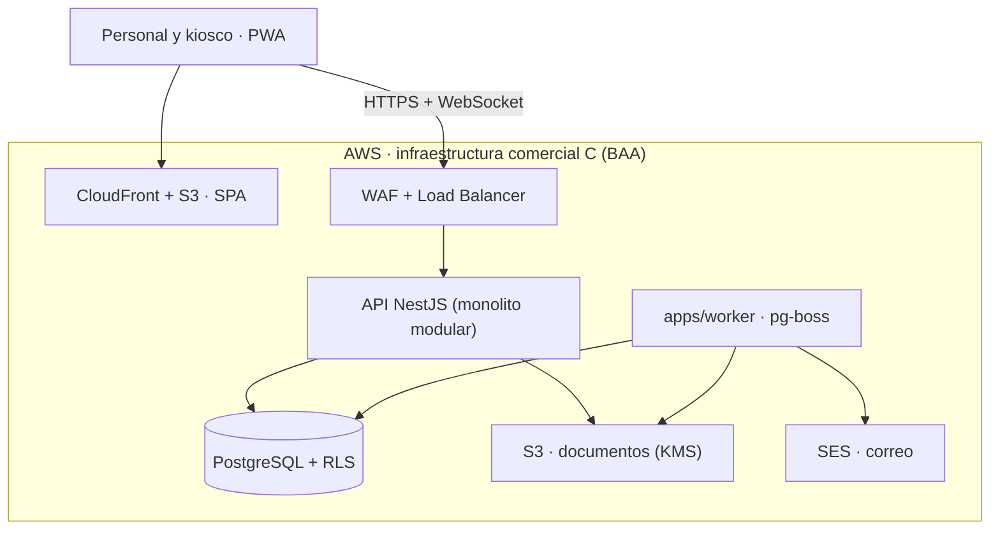

# Clinic System v3 — Arquitectura y plan técnico (revisión 2)

Documento editable y comentable: https://claude.ai/artifact/FzcKU3no2osGePpDBnDC4i. Este archivo es la copia de referencia para Claude Code. Si una decisión cambia, se actualiza aquí y se añade un ADR en `docs/decisions/`.

## Resumen

Se mantiene el stack: React + Vite + TypeScript, Tailwind + shadcn/ui, NestJS + Fastify, PostgreSQL + Drizzle, pg-boss, pnpm y monorepo. La revisión 2 corrige el presupuesto, el diseño multi-tenant, la autenticación (condicionada a una prueba técnica), el kiosco, la auditoría, las operaciones críticas y el plan.

**Límite actual: US$25 al mes en AWS.** El piloto cabe en un solo EC2, con las limitaciones que se detallan en «Entornos y presupuesto».

- **v3:** reconstrucción desde cero del sistema de flujo de pacientes, para venderse o rentarse a varias organizaciones desde una instalación compartida.
- **Especificación funcional:** `docs/manual/` (168 pantallas, 4 roles) y `docs/manual/11_kiosco.md`.
- **Referencia visual:** `design/stitch/`.

## Alcance de V1

| Tema | Decisión para V1 |
| --- | --- |
| Usuarios | App del personal y **kiosco restringido** para pacientes. El kiosco solo envía su registro y nunca lee datos. |
| Integraciones clínicas | **Ninguna:** sin HL7/FHIR, laboratorios externos, recetas electrónicas, verificación de seguros, pasarelas de pago ni SMS. |
| Infraestructura permitida | Solo servicios de AWS de la lista HIPAA Eligible usados bajo el BAA: EC2, EBS, S3, KMS, SES, Route 53, CloudWatch, Systems Manager y AWS Backup; además, en C, RDS, ELB, WAF y CloudFront. GitHub guarda código y datos ficticios, nunca PHI. Amazon Lightsail **no** está en la lista y queda descartado. |
| Cobro del SaaS | Manual en V1, con facturas fuera del sistema. La integración queda para C. |
| Organización y sede | Una organización es una entidad legal (un dueño), y sus sedes comparten pacientes. Las organizaciones independientes no comparten nada. |
| Propietario | Administra la organización (sedes, usuarios, catálogos, reportes y suscripción). **No tiene acceso clínico implícito**: lo obtiene solo si además tiene un rol clínico en una sede. |

## Stack

| Capa | Elección |
| --- | --- |
| Lenguaje | TypeScript (Node.js LTS) |
| Web | React 19 + Vite + TanStack Router/Query, Tailwind 4 + shadcn/ui, React Hook Form + Zod, PWA |
| API | NestJS (Fastify) |
| Worker | `apps/worker`: proceso separado con pg-boss (ADR 0020) |
| Base de datos | PostgreSQL 16 + Drizzle. En B, en el mismo EC2; en C, Amazon RDS. |
| Tiempo real | WebSockets (Socket.IO) + Postgres LISTEN/NOTIFY |
| Autenticación | Better Auth 1.7.7 (ADR 0023, aceptado con condiciones tras la prueba T-002). Los permisos clínicos son siempre nuestros. |
| Archivos | S3 (SSE-KMS, URLs firmadas) |
| PDF | Plantillas HTML impresas con Playwright en el worker. En B, un trabajo a la vez. |
| Correo | Amazon SES |
| Infraestructura como código | AWS CDK (TypeScript) |
| Pruebas | Vitest, Testcontainers (Postgres), Playwright |
| Monorepo | pnpm + Turborepo |

## Arquitectura

El diagrama muestra C. En B todo corre en un solo EC2 (ver «Entornos y presupuesto»).

**Mismo origen:** la API sirve todo bajo `/api` (Better Auth en `/api/auth/*`) y la web la consume desde el mismo origen, sin CORS. En local, el proxy de Vite reenvía `/api`; en B, Caddy. Las cookies de sesión son httpOnly, y la web no guarda tokens ni datos de pacientes (ADR 0014).

**Interfaz compartida:** `packages/ui` tiene los tokens (`tokens.css`) y los componentes de React que usan todas las pantallas: botones, chips de estado y ruta, diálogos (S-GEN-26/27), estados de carga, vacío y error (S-GEN-28), dinero, códigos, fechas en la zona de la sede y tablas (S-GEN-30). React es una dependencia de pares y Tailwind de `apps/web` lee las clases del paquete (`@source`). Los catálogos de estados y rutas de la visita están en `packages/shared`. La página `/dev/ui`, solo en desarrollo, los muestra todos en claro y oscuro.

**Worker:** es un proceso separado (`apps/worker`) que comparte paquetes con la API. En local es un servicio de docker compose; en B, un contenedor aparte en el mismo EC2 con su propio límite de memoria; en C, un servicio de ECS Fargate. Nunca corre dentro del proceso de la API.

| Módulo | Pantallas | Responsabilidad |
| --- | --- | --- |
| `identity` | S-GEN-02..25, S-ADM-02..09 | Inicio de sesión, invitaciones, MFA, sesiones, usuarios, membresías |
| `tenancy` | S-GEN-11, S-GEN-13, S-ADM-10..12 | Organizaciones, sedes, sede activa, dispositivos de kiosco |
| `patients` | S-PAC-01..21 | Pacientes, fusión, documentos, exportación auditada |
| `scheduling` | S-REC-06..17 | Citas |
| `encounters` | S-REC-18..28, S-KIO-01..02, S-CLI-04..16, S-CLI-24 | Llegada, kiosco, visita y sus estados, cobertura, enfermería |
| `orders` | S-CLI-17..22 | Órdenes clínicas |
| `billing` | S-CAJ-01..17 | Cargos, pagos, anulaciones, recibos, saldos |
| `reporting` | S-CAJ-18..23, S-ADM-24..25 | Reportes y CSV |
| `catalogs` | S-ADM-13..23 | Catálogos, precios, membresías, bonos |
| `audit-security` | S-ADM-26..39 | Auditoría, alertas de seguridad |
| `realtime` | S-GEN-14..15, S-REC-04 | Eventos por sede y notificaciones |

## Multi-tenant y permisos

El aislamiento tiene **tres capas**: autorización en la API, RLS en Postgres y claves foráneas compuestas. RLS es una red de seguridad, **no protege contra cualquier error**. No cubre:

- consultas hechas con el rol de migraciones;
- un contexto mal fijado por el servidor;
- datos que salen por S3, WebSockets, logs o exportaciones.

Cada una de esas salidas tiene su control propio.

### Identidad y membresías

- `users` es **global**: una cuenta por correo, con solo datos de acceso. No está bajo RLS de organización y solo la lee el módulo `identity`.
- `memberships (user_id, organization_id, status)` está bajo RLS.
- `membership_roles (membership_id, location_id, role)` asigna roles por sede. `location_id` nulo significa toda la organización y solo se permite para Propietario y Administrador.
- `invitations` + `invitation_roles` (T-006a): una invitación lleva varios roles y sedes, que pasan tal cual a `membership_roles` al aceptarla. El enlace `/invitacion/<token>` lleva la organización y un secreto; solo se guarda el sha256 del secreto.
- **Deshabilitar** a alguien cambia su membresía en **esa** organización. Lo que toca la cuenta global (nombre, MFA, contraseña) solo lo hace una organización si la cuenta no tiene membresías activas en otra; si no, lo hace el operador de la plataforma. Para saberlo sin leer otras organizaciones, la función `app.has_active_membership_elsewhere(user, org)` (SECURITY DEFINER de `clinic_owner`, con una política de solo lectura para ese rol) devuelve solo un sí o un no.

### Permisos

- Los permisos efectivos son la unión de los roles del usuario en la sede activa más sus roles de toda la organización. Se definen en `packages/shared/src/permissions.ts`.
- Propietario y Administrador son roles administrativos. Ver datos clínicos requiere un rol clínico explícito en la sede.
- En cada petición, la API valida que la sede pertenece a la organización y que el usuario tiene membresía activa allí.

### Roles de base de datos

| Rol | Atributos | Uso |
| --- | --- | --- |
| `clinic_owner` | NOLOGIN; dueño del esquema y de las tablas | Solo es propietario de objetos |
| `clinic_migrator` | LOGIN, miembro de `clinic_owner`; NOSUPERUSER, NOBYPASSRLS | Migraciones en CI y en el despliegue. Nunca lo usan la API ni el worker. |
| `clinic_app` | LOGIN, NOSUPERUSER, NOBYPASSRLS, NOCREATEROLE; no es dueño de nada | API y worker. Tiene SELECT/INSERT/UPDATE según la tabla; sin DELETE en finanzas ni en auditoría; solo INSERT en `audit_log`. |

Todas las tablas con datos de una organización tienen `ENABLE` y `FORCE ROW LEVEL SECURITY`.

Los roles los crea un superusuario con `packages/db/sql/bootstrap.sql`, una vez por base de datos y antes de la primera migración: `clinic_migrator` no puede crear roles. La semilla ficticia (solo desarrollo y pruebas) también corre como `clinic_migrator` con `SET ROLE clinic_owner`, fijando el contexto de cada organización.

### Contexto por transacción

- El servidor obtiene `org_id` y `location_id` de la sesión y de la membresía validada, nunca de un encabezado enviado por el cliente.
- Todo el acceso a datos pasa por `withTenant(ctx, fn)`: abre una transacción y ejecuta `set_config('app.org_id', $1, true)`. El valor es local a la transacción, así que no se filtra a la siguiente petición del pool.
- Sin contexto, `current_setting('app.org_id', true)` devuelve NULL y las políticas no dejan ver ni escribir nada.
- **Contexto de usuario (ADR 0023):** `withUser(userId)` fija solo `app.user_id`, desde la sesión validada. Con las políticas `own_memberships_read` y `own_membership_roles_read` (solo `FOR SELECT`), la persona lee sus membresías y roles en todas sus organizaciones; escribir sigue exigiendo `app.org_id`.
- **Comprobación en la CI** (`pnpm check:rls-context`): `app.org_id` y `app.user_id` solo se fijan en `withTenant` / `withUser`, siempre locales a la transacción.

### Políticas

- `USING (organization_id = NULLIF(current_setting('app.org_id', true), '')::uuid)` para SELECT, UPDATE y DELETE. `NULLIF` es necesario porque, en una conexión reutilizada, el valor vuelve a `''` tras la transacción y `''::uuid` lanzaría un error.
- `WITH CHECK` con la misma condición para INSERT y UPDATE.
- `audit_log` solo tiene política de INSERT, sin UPDATE ni DELETE.

### Referencias entre organizaciones

Cada tabla tiene `UNIQUE (organization_id, id)` y las claves foráneas son compuestas. Por ejemplo: `encounters (organization_id, patient_id) REFERENCES patients (organization_id, id)`.

### Pruebas obligatorias

Se ejecutan como `clinic_app`, con el mismo pool que usa la API, sobre Testcontainers:

1. Hay dos organizaciones ficticias, A y B, con datos.
2. En contexto A no se ve ninguna fila de B.
3. Insertar con el `organization_id` de B estando en contexto A falla.
4. Actualizar o mover una fila hacia B falla.
5. Crear una clave foránea hacia una fila de B falla.
6. Una transacción sin contexto no ve nada.
7. En el mismo pool, una transacción de A seguida de otra de B no hereda el contexto.
8. `clinic_app` no puede desactivar RLS, crear roles ni alterar tablas.

### Fuera de la base de datos

- **Worker:** cada trabajo lleva su `organization_id` y se ejecuta dentro de `withTenant` como `clinic_app`.
- **S3:** bucket privado con bloqueo de acceso público y prefijo `org/<org_id>/…`. Las URLs firmadas las emite solo la API, después de autorizar, y duran 5 minutos.
- **WebSockets:** salas `org:<id>:loc:<id>`. La membresía se valida al unirse y al reconectar. Los eventos solo llevan ids y estados, nunca nombres ni datos clínicos.
- **Exportaciones:** las genera el worker con contexto de organización, se guardan bajo el prefijo de la organización, se entregan con enlace de corta duración y se auditan.

## Modelo de datos

Todas las tablas de negocio llevan `organization_id`, `UNIQUE (organization_id, id)` y claves foráneas compuestas. Los ids son UUID v7.

| Entidad | Campos clave | Notas |
| --- | --- | --- |
| `organizations` | name, status | El tenant |
| `locations` | org, code, name, timezone, address (opcional) | `code` es único por organización y aparece en la URL |
| `users` (global) / `memberships` / `membership_roles` | correo; usuario–organización; rol por sede | |
| `patients` | código, nombre, apellidos, fecha de nacimiento, teléfono, merged_into | Pertenecen a la organización |
| `appointments` | sede, paciente, proveedor, tipo, inicio, estado, version | |
| `kiosk_devices` / `kiosk_checkins` | sede, hash del token; datos enviados, estado, vencimiento | |
| `encounters` / `encounter_events` | sede, paciente, cita?, ruta, estado, version; transiciones | Índice único parcial: una sola visita abierta por cita |
| `coverages` | visita, tipo de pagador, plan o membresía | |
| `vitals` / `nursing_assessments` / `patient_allergies` | valores, autor, versión | Versionados |
| `catalog_*` / `prices` | tipos de cita, procedimientos, pruebas; precio por sede con vigencia | Se desactivan, no se borran |
| `orders` / `charges` / `payments` / `receipts` | centavos, estado, anulado_por, motivo | |
| `documents` | paciente, visita?, categoría, s3_key | |
| `code_counters` | org, sede?, tipo, año?, siguiente | |
| `idempotency_keys` / `outbox` | clave, hash de la petición, respuesta; evento, estado | |
| `audit_log` | ver «Auditoría» | Append-only |

## Autenticación: prueba técnica de Better Auth

> **Resultado:** la prueba (T-002) pasó los 8 criterios y Better Auth se adoptó con condiciones: [ADR 0023](decisions/0023-autenticacion.md). Implementación en `apps/api` (T-003). La tabla de abajo queda como registro de lo que se exigió.

Better Auth **no se adopta hasta pasar esta prueba**: una rama desechable de 2 a 3 días con NestJS + Fastify, Drizzle y los roles de base de datos descritos arriba. Better Auth se usa para identidad y sesiones; **los permisos clínicos y por sede son siempre nuestros**.

| # | Qué se prueba | Criterio para aprobar |
| --- | --- | --- |
| 1 | Invitaciones | Enlace de un solo uso que expira. Al aceptarlo se crea una fila en `memberships`. No se puede reutilizar ni falsificar. |
| 2 | Organizaciones | Sus tablas se mapean a nuestras `organizations` y `memberships`, o se desactivan. La fuente de verdad es la nuestra. |
| 3 | MFA por rol | TOTP obligatorio para Propietario y Administrador, aplicado por nuestro guard. Sin MFA no se pasa del paso de inscripción. |
| 4 | Sesiones | Guardadas en la base de datos. Cookie httpOnly + Secure + SameSite. Expiración por inactividad y absoluta. |
| 5 | Revocación | Al desactivar un usuario o quitarle una membresía, sus sesiones y WebSockets se cortan en menos de 1 minuto. |
| 6 | Integración con RLS | Funciona con `clinic_app` sin BYPASSRLS y nunca necesita el rol de migraciones. |
| 7 | Kiosco | El token de dispositivo convive separado de las sesiones de personas. |
| 8 | Auditoría | Los eventos de autenticación se pueden escribir en `audit_log`. |

Si falla el punto 3, 5 o 6, se pasa al plan B: autenticación propia con bibliotecas probadas (argon2, otplib). Suma alrededor de una semana.

## Kiosco

Especificación funcional en `docs/manual/11_kiosco.md`.

- **El motivo no decide nada clínico.** Recepción elige la ruta. La sugerencia motivo → ruta queda desactivada hasta que el director médico de cada organización apruebe por escrito una tabla configurable; esa aprobación se audita.
- **Credencial del dispositivo** (persistente, no es PHI): se vincula con un código de un solo uso. Es un token atado a la organización y la sede con el único permiso `kiosk.submit`, del que solo se guarda el hash en `kiosk_devices`. Va en una cookie httpOnly + Secure, dura 90 días, se renueva al usarse y se puede revocar. Ningún endpoint de lectura la acepta.
- **Datos del paciente** (nunca persistentes en la tableta): solo existen en la memoria de la página. Nada se guarda en localStorage, sessionStorage, IndexedDB ni en la caché del service worker. El autocompletado está desactivado.
- **Limpieza del formulario:** al enviar, tras 60 s de inactividad (con aviso de 10 s), al ocultarse la pestaña y al recargar. La pantalla «Listo» no muestra el nombre del paciente.
- **PWA:** el service worker solo cachea los archivos estáticos. Toda la API responde con `Cache-Control: no-store`, también en la app del personal.
- **En el servidor:** un registro no confirmado vence al cierre del día (hora de la sede) y su contenido se borra a las 24 h. Al confirmarse, los datos pasan al paciente y a la visita, se borra el contenido y solo quedan los metadatos.
- **Protecciones:** límite de envíos por dispositivo, validación en el servidor y `Idempotency-Key` en cada envío.

## Seguridad y HIPAA

Ningún dato real entra al sistema sin tres cosas: **el BAA de AWS firmado**, **solo servicios de la lista HIPAA Eligible** y **una evaluación de riesgos escrita**.

- **Cifrado:** TLS 1.2 o superior. EBS, S3 y los respaldos se cifran con una clave KMS gestionada por el cliente.
- **Acceso al servidor:** solo por Session Manager, sin SSH. Solo los puertos 443 y 80 (este último redirige a HTTPS).
- **Acceso a la app:** MFA para Propietario y Administrador, cierre por inactividad y sesiones revocables.
- **Mínimo necesario:** en pantallas, eventos y notificaciones.
- **Contratos:** cada clínica firma un BAA con nosotros.
- **Datos fuera de producción:** solo ficticios. Nunca se envía PHI a Claude, GitHub ni a herramientas sin BAA.

> Esto es orientación técnica, no asesoría legal.

## Auditoría

| Aspecto | Regla |
| --- | --- |
| Qué se guarda | Organización, sede, actor (usuario o dispositivo), acción, tipo e id de la entidad, fecha y hora, IP o dispositivo, motivo y request id |
| Cambios clínicos | **Solo los nombres de los campos cambiados**, nunca sus valores. El valor anterior vive en la versión anterior del registro. |
| Cambios administrativos y financieros | Antes/después de los campos no clínicos (importe, estado, rol, sede, precio) |
| Lecturas auditadas | Perfil del paciente, documentos, impresión, exportación, búsqueda (el criterio se guarda en hash) y acceso de emergencia |
| Permisos | `clinic_app` solo puede hacer INSERT. Leen el Propietario y el Administrador de la organización. Nadie puede editar ni borrar. |
| Integridad | Cadena de hash por organización. Verificación diaria y último hash guardado en S3 con Object Lock (modo gobernanza). |
| Retención | Configurable por organización y **definida por cada clínica con su asesor**. El valor inicial propuesto es 6 años (el plazo de HIPAA para documentación de políticas). **No es una obligación universal**: los expedientes clínicos pueden tener otros plazos estatales. |

**Logs técnicos** (CloudWatch): errores, tiempos y request ids, **sin datos de pacientes**. Se conservan 30 días, solo los ven los operadores y no reemplazan la auditoría.

## Datos y operaciones críticas

1. **Búsqueda frente a cifrado de campos** *(pendiente de aprobar)*. Propuesta:
   - Cifrado de disco y respaldos con KMS.
   - **Sin cifrado de aplicación** en nombre, apellidos, fecha de nacimiento y teléfono, para permitir búsqueda parcial sin tildes (`pg_trgm` + `unaccent`).
   - Cifrado de aplicación con KMS en los campos que no se buscan: número de miembro del seguro, identificación y notas de cobertura. Si alguno necesita búsqueda exacta, se usa un índice HMAC.
2. **Códigos humanos:** se generan con `code_counters` en la misma transacción que el registro (`UPDATE … SET next = next + 1 RETURNING`). Restricción `UNIQUE (organization_id, code)`.

   | Tipo | Formato | Contador |
   | --- | --- | --- |
   | Paciente | `P-000123` | Organización |
   | Visita | `LAN-V-000123` | Sede |
   | Orden | `LAN-O-000123` | Sede |
   | Recibo | `LAN-R-2026-000045` | Sede y año; sin huecos |

3. **Transacciones:**
   - Orden y cargo se crean en una sola transacción, con el precio vigente de la sede. Cancelar la orden anula el cargo en esa misma transacción.
   - Un pago hace `SELECT … FOR UPDATE` sobre la cuenta de la visita, inserta el pago, recalcula el saldo y escribe la auditoría, todo en una transacción.
   - Las anulaciones son filas inversas.
   - Importes en centavos con `CHECK (amount_cents >= 0)`.
4. **Idempotencia:**
   - `Idempotency-Key` obligatorio en llegada, kiosco, pagos y anulaciones. `idempotency_keys` guarda organización, clave, hash de la petición y respuesta durante 24 h. Misma clave → misma respuesta; misma clave con otro contenido → 409.
   - Restricciones únicas en la base de datos (por ejemplo, una visita abierta por cita).
   - pg-boss usa `singletonKey` y sus trabajos son idempotentes.
5. **Outbox:** los eventos que deben entregarse (correo, notificaciones guardadas, PDF, alertas) se escriben en `outbox` en la misma transacción. El worker los publica al menos una vez y los consumidores eliminan duplicados por id de evento. Los WebSockets de pantalla pueden ir sin outbox, porque la pantalla se resincroniza al reconectar.

## Entornos y presupuesto

**A. Desarrollo local — US$0 en AWS.** Docker compose (Postgres 16, API, worker, web) con dos organizaciones ficticias. CI en GitHub Actions. Staging local.

**B. Demo y piloto económico — unos US$22.83 al mes.**

- Un EC2 t4g.small (2 vCPU, 2 GiB) en us-east-1 que ejecuta, en contenedores, Caddy (TLS y archivos estáticos), la API, el worker y Postgres 16.
- Disco gp3 cifrado con KMS.
- Respaldos: archivo continuo de WAL a S3 (recuperación a un punto en el tiempo, objetivo de pérdida máxima de 5 minutos), copia base diaria en S3 con versionado y snapshot diario del EBS.
- Administración por Session Manager.

| Concepto | Precio unitario (sin franja gratuita) | Cantidad | USD/mes | Fuente |
| --- | --- | --- | --- | --- |
| EC2 t4g.small Linux bajo demanda | $0.0168/h | 730 h | 12.26 | https://calculator.holori.com/aws/ec2/t4g.small/us-east-1 |
| IPv4 pública | $0.005/h | 730 h | 3.65 | https://aws.amazon.com/blogs/aws/new-aws-public-ipv4-address-charge-public-ip-insights |
| EBS gp3 | $0.08/GB-mes | 30 GB | 2.40 | https://www.cloudbolt.io/guide-to-aws-cost-optimization/aws-ebs-pricing/ |
| Snapshots EBS | $0.05/GB-mes | ~10 GB | 0.50 | (misma) |
| KMS, clave del cliente + solicitudes | $1/mes + $0.03 por 10k | 1 | 1.10 | https://aws.amazon.com/kms/pricing/ |
| CloudWatch: logs y alarmas | ~$0.50/GB; ~$0.10/alarma (**por confirmar**) | 1 GB, 5 alarmas | 1.03 | Calculadora de AWS |
| Transferencia de salida | $0.09/GB | 10 GB | 0.90 | https://upstash.com/blog/aws-s3-pricing-explained-2026.md |
| Route 53: zona + consultas | $0.50/zona + $0.40 por millón | 1 | 0.60 | https://aws.amazon.com/route53/pricing/ |
| S3 Standard + solicitudes | $0.023/GB-mes | ~8 GB | 0.28 | https://upstash.com/blog/aws-s3-pricing-explained-2026.md |
| SES | $0.10 por 1.000 | ~1.000 | 0.10 | https://aws.amazon.com/ses/pricing/ |
| **Total** | | | **22.83** | |

No incluye impuestos, el dominio ni consumo por encima de lo estimado.

- Crear una alerta de AWS Budgets en US$20.
- Confirmar los precios en https://calculator.aws/ antes de crear recursos.
- Elegibilidad HIPAA de los servicios: https://aws.amazon.com/compliance/services-in-scope/HIPAA_BAA/

**Lo que B no tiene frente a C (decisión explícita):**

| Control | En B | Consecuencia o mitigación |
| --- | --- | --- |
| Alta disponibilidad y RDS Multi-AZ | No | Si el servidor cae, la app se detiene. Objetivo de restauración: 4 h. Postgres se parchea a mano cada mes. |
| WAF y ALB | No | Límite de peticiones en Caddy y en la API, bloqueo tras intentos fallidos y solo el puerto 443 abierto. Es una protección más débil. |
| Subredes privadas | No | La base de datos no expone ningún puerto. |
| Staging en la nube | No | Staging local, probado con una copia restaurada antes de cada despliegue. |
| Cuentas separadas | No | Una sola cuenta, con MFA en root e IAM mínimo. |

- **Viable en B:** demos con datos ficticios, y **un piloto real con una sola organización** (Lancaster): 1 o 2 sedes, hasta unos 15 usuarios y 1 o 2 kioscos, en horario de clínica. Requisitos previos: BAA firmado, evaluación de riesgos escrita y una restauración probada.
- **No viable en B:** varias organizaciones de pago, compromisos de disponibilidad, operación 24/7 y volúmenes altos de PDF o reportes.

**C. Comercial (futura).** ECS Fargate (API y worker por separado), RDS Multi-AZ, ALB + WAF, CloudFront, subredes privadas, staging en la nube y cuentas separadas. El costo se recalcula en la calculadora cuando llegue el momento. Se pasa a C cuando haya un segundo cliente de pago o se exija alta disponibilidad.

## Plan por fases

Desde la fase 0, todo se prueba con **dos organizaciones ficticias**: «Clínica Demo Norte» y «Clínica Demo Sur», con 2 sedes cada una.

0. **Pruebas técnicas (1–2 semanas):** T-001 (aislamiento), prueba de Better Auth y borrador de la evaluación de riesgos.
1. **Cimientos:** monorepo, CI, `withTenant`, identidad, organizaciones, sedes, membresías y roles, auditoría básica, outbox y worker, marco de la app y semilla de las dos organizaciones.
2. **Pacientes, agenda y catálogo mínimo con precios por sede** (requisito de Caja).
3. **Flujo de la visita (MVP):** llegada, visita sin cita, kiosco, Panel, colas, enfermería, órdenes con cargo, Caja, pagos idempotentes y recibo.
4. **Entorno B y puerta del piloto:** desplegar sin datos reales, firmar el BAA, completar la evaluación de riesgos y **hacer una restauración completa documentada** en un servidor limpio, midiendo los tiempos. Solo entonces empieza el piloto.
5. **Administración y reportes.**
6. **Comercial (C):** alta de organizaciones, migración a C, cobro y segundo cliente.

## De cero al despliegue con Claude Code

1. Repositorio con `CLAUDE.md`, `docs/` y `design/stitch/`.
2. Una tarea pequeña a la vez (`docs/tasks/T-xxx.md`), empezando en modo plan.
3. Rama por tarea; el código va con sus pruebas.
4. En local: `pnpm test`, `pnpm test:e2e` y `pnpm dev`.
5. PR con CI (lint, tipos, pruebas, migraciones contra un Postgres limpio) → merge en verde.
6. Repetir por pantalla y por flujo. Cada flujo de rol termina con su prueba E2E.
7. Fase 4: CDK para B, revisado y desplegado por el dueño de la cuenta. Las imágenes van a GitHub Container Registry, porque ECR queda fuera del presupuesto.
8. Despliegue: GitHub Actions + Systems Manager. El servidor descarga las imágenes, ejecuta las migraciones con `clinic_migrator`, reinicia los servicios y vuelve a la versión anterior si fallan las pruebas de humo.
9. Después del despliegue:
   - pruebas de humo (salud, inicio de sesión, aislamiento entre las dos organizaciones);
   - simulacro de restauración;
   - aceptación con el personal de Lancaster, usando un guion por rol y datos ficticios.
10. Piloto tras la puerta de la fase 4.

Primera tarea: `docs/tasks/T-001-aislamiento-multitenant.md`.
