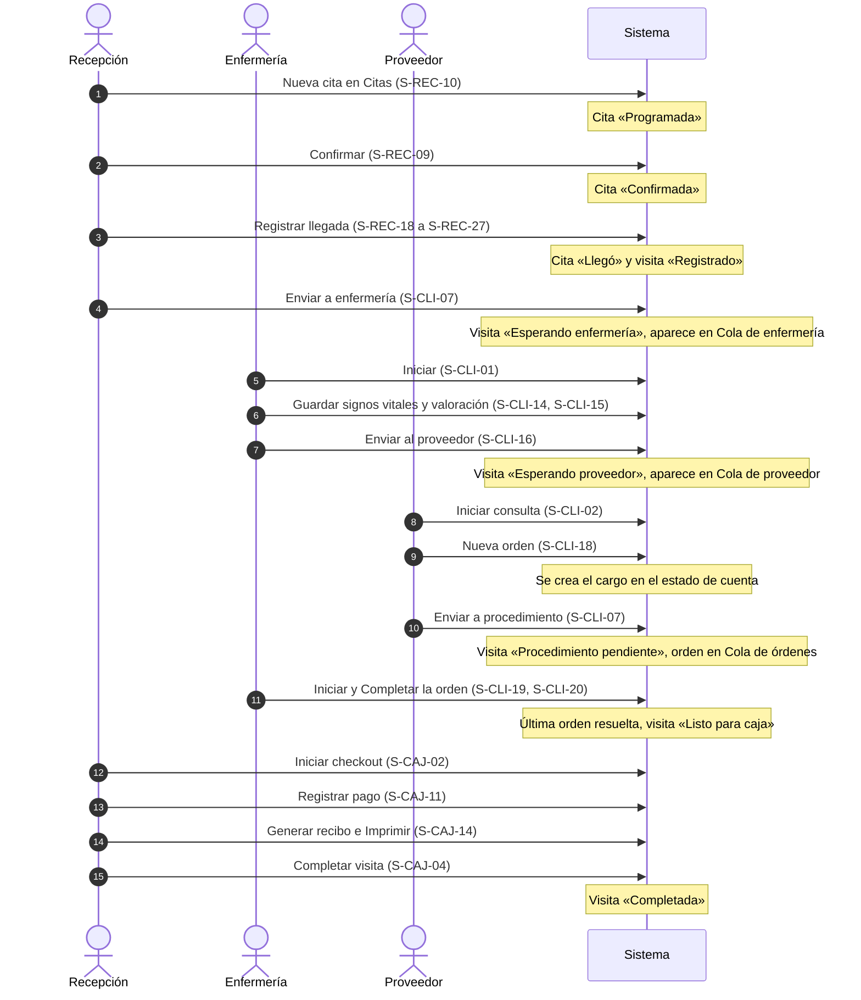
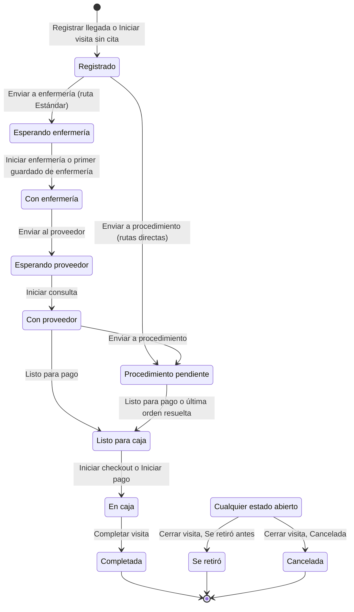
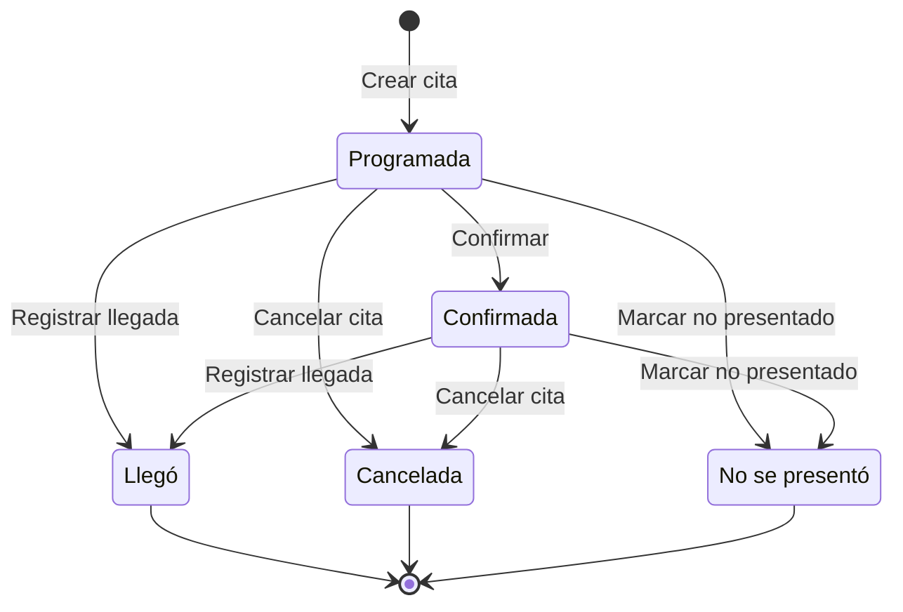

# Manual de usuario — Clínica Hispana Lancaster

Manual funcional de la aplicación de la clínica (web y Android). Describe qué hace cada pantalla, quién puede usarla y cómo se encadenan los flujos de trabajo de cada rol. Se redactó a partir del código de la rama `dev` (frontend Flutter y backend Rust) y de los documentos de especificación `docs/05_WORKFLOW_STATE_MACHINE.md`, `docs/06_RBAC_MATRIX.md` y `docs/10_AUTH_SECURITY.md`. Los datos de ejemplo (nombres, códigos, importes) son ficticios.

## Contenido

1. [Cómo usar este manual](README.md#inicio--como-usar-este-manual)
2. [Los cuatro roles](README.md#inicio--los-cuatro-roles)
3. [Estructura de la aplicación](README.md#inicio--estructura-de-la-aplicacion)
4. [Flujo completo de la visita del paciente](README.md#inicio--flujo-completo-de-la-visita-del-paciente)
5. [Comportamientos transversales](README.md#inicio--comportamientos-transversales)
6. [Glosario de estados y chips](README.md#inicio--glosario-de-estados-y-chips)
7. [Glosario de términos](README.md#inicio--glosario-de-terminos)
8. [Matriz pantalla × rol](README.md#inicio--matriz-pantalla--rol)
9. [Notas para el rediseño visual](README.md#inicio--notas-para-el-rediseno-visual)
10. [Preguntas abiertas para producto](README.md#inicio--preguntas-abiertas-para-producto)

---

## Cómo usar este manual

### Para quién es

| Lector | Qué buscar |
| --- | --- |
| Producto, diseño y desarrollo (rediseño visual) | La [matriz pantalla × rol](README.md#inicio--matriz-pantalla--rol), el catálogo de pantallas (archivos 05 a 10) y las [notas para el rediseño](README.md#inicio--notas-para-el-rediseno-visual). Cada ficha de pantalla trae un bloque «Notas para el rediseño» con lo que hay que conservar y las inconsistencias observadas. |
| Personal de la clínica | La guía de su rol (archivos 01 a 04): un día típico, los flujos paso a paso, lo que puede y no puede hacer y qué significan los errores frecuentes. |

### Archivos del manual

| Archivo | Contenido |
| --- | --- |
| `README.md` (este archivo) | Visión general, roles, estructura, flujo de la visita, comportamientos transversales, glosarios, matriz y notas para el rediseño. |
| <01_recepcion.md> | Guía del rol Recepción. |
| <02_enfermeria.md> | Guía del rol Enfermería / asistente médico. |
| <03_proveedor.md> | Guía del rol Proveedor. |
| <04_administrador.md> | Guía del rol Administrador. |
| <05_pantallas_generales.md> | Pantallas `S-GEN`: arranque, inicio de sesión, verificación en dos pasos, selección de sede, marco de la aplicación, notificaciones, perfil y componentes comunes. |
| <06_pantallas_pacientes.md> | Pantallas `S-PAC`: búsqueda, alta, perfil, edición y fusión de pacientes; documentos; registro de exportación. |
| <07_pantallas_recepcion.md> | Pantallas `S-REC`: Panel, agenda de citas, registro de llegada y visitas sin cita. |
| <08_pantallas_clinicas.md> | Pantallas `S-CLI`: colas de enfermería, proveedor y órdenes; pantalla de la visita; enfermería; órdenes. |
| <09_pantallas_caja.md> | Pantallas `S-CAJ`: caja, estado de cuenta, pagos, recibos, saldos y reportes. |
| <10_pantallas_admin.md> | Pantallas `S-ADM`: usuarios, sedes, catálogos, precios, reglas de bono, auditoría, configuración y seguridad. |

### Convenciones

- **Identificador de pantalla.** Cada pantalla, diálogo, hoja o panel tiene un ID estable (`S-GEN-03`, `S-CLI-14`…). Los IDs enlazan con su ficha en el catálogo y son la referencia común entre diseño, desarrollo y personal.
- **Etiquetas exactas.** El texto entre comillas angulares («Registrar llegada») es la etiqueta literal que muestra la interfaz en español. Si la interfaz está en inglés, la etiqueta equivalente está en `frontend/lib/l10n/app_en.arb`.
- **Acceso.** ✅ completo (usa todas las acciones de la pantalla), ◐ limitado (entra, pero con acciones ocultas, solo lectura o datos parciales), ❌ sin acceso (el menú no la muestra y la ruta redirige o el servidor la rechaza).
- **Rutas.** La sede activa va en la URL: `/app/<CÓDIGO>/…` (por ejemplo `/app/LAN/dashboard`). Las pantallas de administración de la compañía viven en `/admin/…` y no llevan sede.
- **La interfaz no es la autoridad.** Ocultar un botón es solo presentación. El servidor valida usuario activo, sesión, sede asignada, permiso del rol y regla de negocio en cada operación; si algo se ve pero el servidor lo rechaza, aparece un mensaje de error (ver [Mensajes de error comunes](README.md#inicio--mensajes-de-error-comunes)).

---

## Los cuatro roles

Un usuario puede tener uno o varios roles. Sus permisos efectivos son la **unión** de los permisos de sus roles, limitada a las **sedes asignadas** (docs/06 «Multiple roles»). El alta de personal es solo por invitación de un Administrador.

| Rol (etiqueta en la interfaz) | Qué hace en la clínica | Destinos del menú | Guía |
| --- | --- | --- | --- |
| **Administrador** | Configura el sistema, gestiona usuarios, sedes, catálogos, precios y reglas de bono; revisa auditoría, alertas de seguridad y reportes de toda la compañía; puede ejecutar cualquier paso del flujo clínico y hacer correcciones excepcionales (fusionar pacientes, forzar estados, anular cargos y pagos). | Panel, Pacientes, Citas, Cola de enfermería, Cola de proveedor, Cola de órdenes, Caja, Reportes y la sección «Administración»: Usuarios, Sedes, Catálogos, Planes de membresía, Reglas de bono, Reportes de la compañía, Auditoría, Configuración, Seguridad. | <04_administrador.md> |
| **Recepción** | Registra pacientes, agenda y gestiona citas, registra la llegada (check-in) y las visitas sin cita, captura la cobertura, envía al paciente a enfermería o a procedimiento, asigna proveedor, cobra, emite recibos y consulta el reporte de su sede. | Panel, Pacientes, Citas, Caja, Reportes. | <01_recepcion.md> |
| **Enfermería / asistente médico** (Enfermería / MA) | Atiende la cola de enfermería, registra signos vitales y la valoración de enfermería, envía al paciente al proveedor y ejecuta las órdenes clínicas (inyecciones, laboratorios, procedimientos). | Panel, Pacientes, Cola de enfermería, Cola de órdenes. | <02_enfermeria.md> |
| **Proveedor** (médico o profesional que atiende) | Atiende su cola, inicia la consulta, revisa enfermería y corrige signos vitales, crea y cancela órdenes, ejecuta órdenes, marca la visita lista para pago y gestiona sus propias citas. | Panel, Pacientes, Citas, Cola de enfermería, Cola de proveedor, Cola de órdenes. | <03_proveedor.md> |

### Resumen de permisos (docs/06)

| Capacidad | Administrador | Recepción | Enfermería / MA | Proveedor |
| --- | --- | --- | --- | --- |
| Gestionar sedes | ✅ | ❌ | ❌ | ❌ |
| Invitar y gestionar usuarios, asignar roles y sedes | ✅ | ❌ | ❌ | ❌ |
| Reactivar un usuario deshabilitado | ✅ | ❌ | ❌ | ❌ |
| Restablecer la verificación en dos pasos de otro usuario | ✅ | ❌ | ❌ | ❌ |
| Gestionar la propia verificación en dos pasos | ✅ | ✅ | ✅ | ✅ |
| Crear paciente | ✅ | ✅ | ❌ | ❌ |
| Buscar paciente | ✅ | ✅ | ✅ | ✅ |
| Editar datos básicos del paciente | ✅ | ✅ | ❌ | ◐ solo teléfono |
| Fusionar pacientes | ✅ | ❌ | ❌ | ❌ |
| Crear y editar citas | ✅ | ✅ | ❌ | ◐ solo las propias |
| Registrar llegada (check-in) y elegir la sede de la visita | ✅ | ✅ | ❌ | ❌ |
| Ver la cola de la sede | ✅ | ✅ | ✅ | ✅ |
| Registrar y corregir signos vitales | ✅ | ❌ | ✅ | ✅ |
| Registrar la valoración de enfermería | ✅ | ❌ | ✅ | ❌ |
| Ver datos de enfermería | ✅ | ◐ solo estado y fechas | ✅ | ✅ |
| Crear orden clínica | ✅ | ❌ | ❌ | ✅ |
| Ejecutar orden | ✅ | ❌ | ✅ | ✅ |
| Gestionar procedimientos, laboratorios, precios y reglas | ✅ | ❌ | ❌ | ❌ |
| Ver cargos | ✅ | ✅ | ◐ solo totales | ✅ |
| Registrar pago manual y generar recibo | ✅ | ✅ | ❌ | ❌ |
| Ver reportes financieros | ✅ | ◐ su sede, sin saldo pendiente ni bono | ❌ | ❌ |
| Subir documentos del paciente | ✅ | ✅ | ✅ | ✅ |
| Registrar una exportación antes de imprimir, descargar o compartir | ✅ | ✅ | ✅ | ✅ |
| Ver el registro de auditoría | ✅ | ❌ | ❌ | ❌ |
| Gestionar configuración, integraciones y estado del sistema | ✅ | ❌ | ❌ | ❌ |
| Cambio excepcional de estado de una visita | ✅ | ❌ | ❌ | ❌ |
| Ver y reconocer alertas de seguridad | ✅ | ❌ | ❌ | ❌ |

Reglas de seguridad de la cuenta que afectan a todos los roles:

- Los roles listados en el ajuste `auth.mfa.required_roles` (por defecto solo Administrador) no obtienen sesión sin verificación en dos pasos.
- El último Administrador activo nunca puede deshabilitarse, eliminarse ni perder el rol (`last_administrator`). Si nadie puede entrar como Administrador, el acceso se recupera en el servidor con el comando `clinic-backend break-glass`, nunca desde la aplicación.

---

## Estructura de la aplicación

### Del arranque al trabajo

1. **Arranque** — [S-GEN-01](#s-gen-01). La app restaura la sesión guardada (si la hay) y decide a dónde ir. En el primer arranque de una instalación nueva lleva a la configuración inicial [S-GEN-02](#s-gen-02).
2. **Inicio de sesión** — [S-GEN-03](#s-gen-03) con correo y contraseña, o con Google si está habilitado. No hay registro público: se entra por invitación [S-GEN-09](#s-gen-09). Las contraseñas olvidadas se resuelven con un enlace que emite un Administrador [S-GEN-10](#s-gen-10).
3. **Verificación en dos pasos** — si la cuenta la tiene, código de 6 dígitos [S-GEN-06](#s-gen-06); si el rol la exige y aún no está configurada, inscripción [S-GEN-07](#s-gen-07) y códigos de recuperación [S-GEN-08](#s-gen-08).
4. **Sede del día** — con varias sedes y ninguna recordada se elige en [S-GEN-11](#s-gen-11); con una sola se elige sola.
5. **Marco de la aplicación** — [S-GEN-12](#s-gen-12): cabecera con selector de sede [S-GEN-13](#s-gen-13), indicador en vivo [S-GEN-14](#s-gen-14), búsqueda de pacientes, notificaciones [S-GEN-15](#s-gen-15) y menú de cuenta [S-GEN-16](#s-gen-16); franja de banners ([S-GEN-18](#s-gen-18), [S-GEN-19](#s-gen-19)); navegación con los destinos del rol.
6. **Inicio** — para todos los roles es el Panel de la sede activa [S-REC-01](#s-rec-01) (`/app/<CÓDIGO>/dashboard`).

### Navegación según el tamaño de pantalla

La tableta es el objetivo principal del diseño.

| Ancho | Navegación | Listas | Formularios |
| --- | --- | --- | --- |
| Menos de 600 px (teléfono) | Botón de menú (cajón con todos los destinos y el encabezado «Administración») + barra inferior con los 5 primeros destinos del rol | Tarjetas | Pantalla completa; hojas inferiores; botón flotante para «Nuevo» |
| 600 a 1024 px (tableta) | Riel de navegación con etiquetas (se desplaza si no cabe) | Tablas con desplazamiento horizontal | Diálogos |
| Más de 1024 px (escritorio) | Navegación lateral fija de 260 px | Tablas; colas en dos columnas | Diálogos |

Destinos de la barra inferior en teléfono: Recepción — Panel, Pacientes, Citas, Caja, Reportes; Enfermería — Panel, Pacientes, Cola de enfermería, Cola de órdenes; Proveedor — Panel, Pacientes, Citas, Cola de enfermería, Cola de proveedor («Cola de órdenes» queda en el cajón); Administrador — Panel, Pacientes, Citas, Cola de enfermería, Cola de proveedor (Cola de órdenes, Caja, Reportes y toda la Administración quedan en el cajón).

### Rutas principales

| Ruta | Pantalla |
| --- | --- |
| `/setup`, `/login`, `/invite/<token>`, `/reset/<token>` | Páginas públicas ([S-GEN-02](#s-gen-02), [S-GEN-03](#s-gen-03), [S-GEN-09](#s-gen-09), [S-GEN-10](#s-gen-10)) |
| `/select-location` | Seleccionar sede [S-GEN-11](#s-gen-11) |
| `/app/<CÓDIGO>/dashboard` | Panel [S-REC-01](#s-rec-01) |
| `/app/<CÓDIGO>/patients`, `/patients/<id>`, `/patients/<id>/merge` | Pacientes [S-PAC-01](#s-pac-01), perfil [S-PAC-05](#s-pac-05), fusión [S-PAC-13](#s-pac-13) |
| `/app/<CÓDIGO>/patients/<id>/documents` | Documentos del paciente [S-PAC-19](#s-pac-19) (solo por URL) |
| `/app/<CÓDIGO>/appointments?date=AAAA-MM-DD` | Citas [S-REC-06](#s-rec-06) |
| `/app/<CÓDIGO>/checkin/<cita>`, `/checkin/walk-in` | Registro de llegada [S-REC-18](#s-rec-18), visita sin cita [S-REC-19](#s-rec-19) |
| `/app/<CÓDIGO>/encounters/<visita>` (opcional `?section=orders`, `?section=nursing` o `?section=billing`) | Visita [S-CLI-04](#s-cli-04) |
| `/app/<CÓDIGO>/encounters/<visita>/documents` | Documentos de la visita [S-CLI-25](#s-cli-25) / [S-PAC-20](#s-pac-20) (solo por URL) |
| `/app/<CÓDIGO>/nursing/queue`, `/provider/queue`, `/orders/queue` | Colas [S-CLI-01](#s-cli-01), [S-CLI-02](#s-cli-02), [S-CLI-03](#s-cli-03) |
| `/app/<CÓDIGO>/checkout/queue`, `/checkout/<visita>` | Caja [S-CAJ-01](#s-caj-01), checkout [S-CAJ-03](#s-caj-03) |
| `/app/<CÓDIGO>/reports` | Reportes de la sede [S-CAJ-18](#s-caj-18) |
| `/app/<CÓDIGO>/profile` | Perfil [S-GEN-21](#s-gen-21) |
| `/admin/…` | Administración ([S-ADM-01](#s-adm-01) y siguientes) |

---

## Flujo completo de la visita del paciente

### Recorrido entre roles

Variantes:

- **Sin procedimientos:** desde «Con proveedor» el Proveedor pulsa «Listo para pago» y la visita pasa a «Listo para caja».
- **Rutas directas** («Solo inyección», «Solo laboratorio», «Solo procedimiento»): Recepción pulsa «Enviar a procedimiento» desde «Registrado»; no hay etapa de enfermería ni de proveedor. Un Proveedor o el Administrador crea las órdenes (permitido ya en «Registrado») y Enfermería las ejecuta.
- **Visita sin cita:** Recepción usa «Sin cita» en Citas [S-REC-19](#s-rec-19); el resto del flujo es igual.
- **El paciente se va o la visita se anula:** Recepción usa «Cerrar visita…» [S-CLI-09](#s-cli-09) con motivo obligatorio.
- **Corrección excepcional:** solo el Administrador, con «Forzar estado…» [S-CLI-10](#s-cli-10) y motivo; queda marcado «Forzado» en el historial.

### Estados de la visita (docs/05)

«Cualquier estado abierto» representa los ocho estados anteriores a «Completada». El Administrador puede además forzar cualquier estado (incluso reabrir una visita cerrada) con «Forzar estado…».

| Desde | Acción (botón) y pantalla | Hacia | Rol dueño del paso | Reglas |
| --- | --- | --- | --- | --- |
| — | «Registrar llegada» [S-REC-26](#s-rec-26) / «Iniciar visita sin cita» | Registrado | Recepción | La cita pasa a «Llegó». Una sola visita abierta por paciente y sede. |
| Registrado | «Enviar a enfermería» [S-CLI-07](#s-cli-07) | Esperando enfermería | Recepción | Solo ruta Estándar. |
| Registrado | «Enviar a procedimiento» [S-CLI-07](#s-cli-07) | Procedimiento pendiente | Recepción | Solo rutas directas. |
| Esperando enfermería | «Iniciar» [S-CLI-01](#s-cli-01) o «Iniciar enfermería» [S-CLI-07](#s-cli-07) | Con enfermería | Enfermería | También automático con el primer guardado de signos vitales o valoración hecho por Enfermería o el Administrador en ruta Estándar. |
| Con enfermería | «Enviar al proveedor» [S-CLI-16](#s-cli-16) (o la barra [S-CLI-07](#s-cli-07)) | Esperando proveedor | Enfermería | Desde la sección Enfermería el servidor exige peso o presión arterial guardados. |
| Esperando proveedor | «Iniciar consulta» [S-CLI-02](#s-cli-02) o [S-CLI-07](#s-cli-07) | Con proveedor | Proveedor | Desde la cola se autoasigna si la visita no tenía proveedor. |
| Con proveedor | «Enviar a procedimiento» [S-CLI-07](#s-cli-07) | Procedimiento pendiente | Proveedor | Crear una orden no mueve la visita: hay que pulsar este botón. |
| Con proveedor | «Listo para pago» [S-CLI-07](#s-cli-07) | Listo para caja | Proveedor | Bloqueado con órdenes pendientes o en curso ([S-CLI-08](#s-cli-08)). |
| Procedimiento pendiente | «Listo para pago» [S-CLI-07](#s-cli-07) | Listo para caja | Enfermería o Proveedor | Bloqueado con órdenes abiertas. Automático cuando se completa o cancela la última orden abierta. |
| Listo para caja | «Iniciar checkout» [S-CAJ-02](#s-caj-02), [S-CAJ-04](#s-caj-04) o «Iniciar pago» [S-CLI-07](#s-cli-07) | En caja | Recepción | Bloqueado con órdenes abiertas ([S-CAJ-06](#s-caj-06)). |
| En caja | «Completar visita» [S-CAJ-04](#s-caj-04) o [S-CLI-07](#s-cli-07) | Completada | Recepción | En [S-CAJ-04](#s-caj-04), con saldo pendiente pide confirmación [S-CAJ-05](#s-caj-05). |
| Cualquier estado abierto | «Cerrar visita…» [S-CLI-09](#s-cli-09) | Se retiró / Cancelada | Recepción | Motivo obligatorio (máx. 500). |
| Cualquiera | «Forzar estado…» [S-CLI-10](#s-cli-10) | Cualquier otro (no cierre) | Administrador | Motivo obligatorio; chip «Forzado» en el historial [S-CLI-24](#s-cli-24). |

El Administrador tiene todos los permisos y puede ejecutar cualquier paso. Toda transición envía la versión del registro (concurrencia optimista, ver [Conflictos de versión](README.md#inicio--conflictos-de-version)).

### Estados de la cita

«Llegó», «Cancelada» y «No se presentó» son finales. Editar y Reprogramar solo están disponibles en «Programada» y «Confirmada».

### Estados de la orden clínica

`Pendiente → En curso → Completada`, o `Pendiente / En curso → Cancelada` (con motivo). Crear una orden crea su cargo en el estado de cuenta; cancelarla lo anula.

### Estado de cuenta de la visita

«Abierto» → «Pago parcial» → «Pagado». Un estado de cuenta «Anulado» no admite cambios. El servidor calcula todas las cifras; la aplicación solo les da formato.

---

## Comportamientos transversales

### Sede activa

- La sede de trabajo va en la URL (`/app/<CÓDIGO>/…`) y viaja en cada operación de sede; el servidor la valida contra las sedes asignadas al usuario y nunca la acepta sin comprobar.
- Se cambia con el selector de la cabecera [S-GEN-13](#s-gen-13) (con dos o más sedes). Si hay formularios con cambios sin guardar se pide confirmación [S-GEN-26](#s-gen-26). Tras el cambio siempre se aterriza en el Panel de la nueva sede.
- Abrir un enlace a otra sede propia (una visita de otra sede, una notificación) cambia la sede automáticamente; si hay formularios con cambios, la navegación se rechaza en silencio y se queda en la URL anterior.
- Una sede no asignada en la URL devuelve al inicio sin mensaje.
- La sede se recuerda en el dispositivo para el próximo inicio; se olvida en los cierres forzados (inactividad, sesión revocada, usuario desactivado).
- Los **pacientes son de toda la compañía** (búsqueda y perfil no se limitan a la sede). Citas, visitas, saldos y documentos de visita se limitan a las sedes asignadas. El código humano del paciente es por sede (`LAN-P-000001`, `DAL-P-000042`).
- Fechas y horas se muestran en la zona horaria de la sede activa (por defecto `America/Chicago`), nunca en la del dispositivo. «Hoy» es el día de calendario de la sede.

### Cierre automático de sesión por inactividad

- Límite configurable por el Administrador: `auth.idle_logout_minutes` (5 a 120, por defecto 15 minutos), aplicado en caliente.
- 60 segundos antes del límite aparece el aviso «¿Sigues ahí?» con cuenta regresiva [S-GEN-20](#s-gen-20): «Mantener la sesión» reinicia el periodo; «Cerrar sesión» sale de inmediato.
- Solo cuenta la entrada real (toques, ratón que se mueve, rueda, teclas, texto escrito). Los refrescos en vivo, los sondeos y las llamadas automáticas no cuentan.
- Al expirar, una cubierta opaca «Cerrando sesión…» oculta la pantalla, se cierran diálogos y avisos, y la app vuelve a `/login?reason=idle` con «Se cerró tu sesión tras {minutes} minutos de inactividad.». El siguiente usuario empieza en su propio inicio: no se conserva la pantalla anterior.
- El servidor también corta la sesión tras el límite más 2 minutos sin actividad reportada.
- En Android la app bloquea capturas de pantalla y la miniatura de recientes.

### Verificación en dos pasos

- Aplicación de autenticación (TOTP, códigos de 6 dígitos que cambian cada 30 segundos) más 10 códigos de recuperación de un solo uso (`XXXX-XXXX-XXXX`).
- Obligatoria para los roles de `auth.mfa.required_roles` (por defecto Administrador); voluntaria para el resto desde el Perfil ([S-GEN-22](#s-gen-22) a [S-GEN-25](#s-gen-25)). Un rol que la exige no puede desactivarla.
- Diez códigos erróneos seguidos bloquean el factor: solo un Administrador lo restablece [S-ADM-08](#s-adm-08), lo que también reemplaza la contraseña.
- Configurarla desde el Perfil pide la contraseña actual; cinco contraseñas erróneas seguidas cierran todas las sesiones del usuario.
- Los secretos (reto, clave, códigos) viven solo en memoria; el portapapeles con secretos se borra al continuar, al minuto o al salir. Los enlaces de invitación y los tokens de restablecimiento que muestra Administración siguen la misma regla ([S-ADM-04](#s-adm-04)).

### Conflictos de versión

Cada cambio envía la versión del registro que se está viendo. Si otra persona lo modificó antes, el servidor rechaza el cambio (ABORTED) y la pantalla avisa y se recarga. Nunca se sobrescribe el trabajo de otro. Textos según la pantalla:

| Contexto | Mensaje |
| --- | --- |
| Genérico | «Este registro fue actualizado por otro usuario. Actualice para continuar.» |
| Editar paciente | Diálogo «Actualizado por otro usuario» [S-PAC-12](#s-pac-12) |
| Citas | Diálogo «Actualizada por otro usuario» [S-REC-16](#s-rec-16) |
| Barra de acciones de la visita, Cola de proveedor | «Otra persona actualizó esta visita. La pantalla se ha actualizado.» |
| Órdenes | «Otro usuario actualizó esta orden. La lista se ha actualizado.» |
| Caja | «Otra persona actualizó el estado de cuenta. Se ha actualizado.» |
| Administración | Mensaje genérico + «Actualice la lista e intente de nuevo.» con botón «Actualizar» |

### Tiempo real

- Un único WebSocket por sesión. Los mensajes solo llevan IDs y versiones, nunca datos de pacientes; la pantalla vuelve a leer los datos del servidor.
- Indicador de la cabecera [S-GEN-14](#s-gen-14): «En vivo», «Reconectando…» o «Sin conexión». El Panel tiene además su propio indicador [S-REC-05](#s-rec-05).
- Mientras no hay conexión en vivo, la pantalla visible se refresca sola cada 30 segundos; tras cada reconexión se vuelven a leer los datos.
- Las recargas en vivo nunca vacían la pantalla: muestran una barra fina arriba y conservan el desplazamiento y los formularios.
- Las notificaciones [S-GEN-15](#s-gen-15) llegan solo por el canal en vivo, viven en memoria (máximo 100) y se pierden al recargar o cerrar sesión.
- Usuarios, sedes, catálogos, auditoría y reportes no se actualizan en vivo: se recargan con «Actualizar».

### Configuración incompleta y modo degradado

| Situación | Qué ve el usuario | Efecto |
| --- | --- | --- |
| **Configuración incompleta** (faltan ajustes obligatorios) | Administrador: banner «La configuración del sistema está incompleta. Solo Administración → Configuración está disponible hasta terminarla.» [S-GEN-18](#s-gen-18) y notificación «Configuración incompleta». Resto: el error «La configuración del sistema está incompleta.» en las pantallas cuyas operaciones fallan. | El servidor bloquea la operación clínica hasta completar la configuración ([S-ADM-28](#s-adm-28) a [S-ADM-32](#s-adm-32)). |
| **Modo degradado** (configuración completa, pero no responde el almacenamiento de documentos o la mensajería) | Banner [S-GEN-19](#s-gen-19): «Los documentos no están disponibles por el momento. Todo lo demás funciona con normalidad.», «Las actualizaciones en vivo están demoradas: las pantallas se actualizan solas cada 30 segundos.» o «Documentos no disponibles y actualizaciones en vivo demoradas. El trabajo clínico continúa con normalidad.» | El trabajo clínico (pacientes, visitas, signos vitales, facturación) sigue guardándose. Solo se afectan los documentos y la inmediatez. |

### Registro de exportación antes de imprimir, descargar o compartir

Toda salida de datos de la app (imprimir un recibo o un reporte, exportar CSV, compartir un PDF) se registra en la auditoría **antes** de producirse (HIPAA 164.312(b)). Si el registro falla, no se produce nada y aparece «Exportación cancelada: no se pudo registrar en la auditoría. Inténtelo de nuevo en un momento.» Límite: 30 exportaciones por minuto por usuario. Ver [S-PAC-21](#s-pac-21) y [S-CAJ-24](#s-caj-24). Ver o descargar documentos no pasa por este registro: el servidor audita cada enlace de descarga que emite.

### Idiomas

Español e inglés. Antes de entrar, el menú de idioma de las páginas públicas cambia el idioma solo en el dispositivo; dentro, el menú de cuenta [S-GEN-16](#s-gen-16) y el Perfil [S-GEN-21](#s-gen-21) lo guardan también en el servidor. En cada inicio de sesión manda la preferencia del servidor. Los recibos se pueden ver e imprimir en el otro idioma desde [S-CAJ-15](#s-caj-15). Los nombres de catálogo tienen versión en español y en inglés.

### Datos protegidos (PHI) y cifrado

- Se guardan cifrados: nombres de pacientes (en MAYÚSCULAS antes de cifrar; la interfaz los muestra en formato Título), fecha de nacimiento, teléfono, notas clínicas, alergias, antecedentes y síntomas, datos de seguro, detalles de referencia, nombres de archivo de documentos, referencias de pago manual y los motivos escritos por el personal (cancelaciones, cierres, forzados, anulaciones, reactivaciones, reconocimientos de alertas).
- La búsqueda por nombre, fecha de nacimiento o teléfono es **exacta** (índice ciego): «Maria» no encuentra «María» y no hay coincidencias parciales.
- Cada lectura de datos de pacientes queda auditada en el servidor; si la auditoría falla, la lectura falla.
- Notificaciones, eventos en vivo y registros técnicos no llevan datos de pacientes: solo códigos humanos (`LAN-E-000123`) e IDs. Los UUID nunca se muestran en pantalla (salvo en Auditoría y Seguridad, para el Administrador).
- El texto clínico en modo lectura (valoración, recibo) no se puede seleccionar ni copiar.
- La Cola de órdenes no muestra nombres de pacientes ni notas clínicas; Recepción ve de enfermería solo estado y fechas.
- **Nada del usuario anterior queda en el dispositivo.** Cada cierre de sesión (voluntario, en todos los dispositivos, forzado o por inactividad, también el que se hace al abrir la app con la sesión vencida) borra tokens, cachés de sesión y notificaciones, vacía la cola de subidas [S-PAC-16](#s-pac-16) (aborta lo que esté subiendo y borra las copias locales de los archivos), vacía en Android las carpetas de caché de los selectores de archivos y de compartir, y descarta las vistas previas de imágenes guardadas en memoria [S-PAC-17](#s-pac-17).
- **Copias locales en Android.** Los selectores de archivos y de fotos y la hoja de compartir trabajan con una copia en la caché privada de la app. La de cada archivo se borra al terminar, cancelar o descartar su subida; la del PDF de un recibo compartido, al compartir el recibo siguiente (la app elegida puede seguir leyéndola tras cerrarse la hoja) [S-CAJ-15](#s-caj-15); y al cerrar sesión se borran todas, también las fotos de una subida cortada por un cierre forzado. En la web no se guarda nada en disco.
- **Sin copia de seguridad en la nube.** En Android la app queda fuera de la copia de seguridad automática del sistema (`allowBackup=false`, `fullBackupContent=false`): ni el almacenamiento seguro (token de renovación, marca de inactividad) ni las preferencias se suben a esa copia. Restaurado en otro dispositivo, el almacenamiento seguro tampoco serviría: la clave del Keystore no viaja con él.
- **Portapapeles de los secretos de un solo uso** (clave y códigos de la verificación en dos pasos, enlaces de invitación, tokens de restablecimiento): la app lo vacía al continuar o cerrar, al cabo de un minuto y cuando la pantalla desaparece, solo si aún contiene lo copiado (en la web lo vacía sin comprobar y, fuera de un toque, el navegador puede impedirlo). El historial o la sincronización del portapapeles del sistema pueden conservar una copia ([S-GEN-07](#s-gen-07), [S-GEN-08](#s-gen-08), [S-ADM-04](#s-adm-04)).

### Estados de carga, vacío y error

Todas las pantallas comparten cinco estados [S-GEN-28](#s-gen-28): cargando (indicador circular), refrescando (barra fina arriba sin borrar datos), vacío (icono + texto), error sin datos («Algo salió mal» + mensaje + «Reintentar») y error con datos (banner rojo compacto arriba + «Reintentar»).

### Mensajes de error comunes

El texto nunca es el mensaje técnico del servidor: sale del motivo (`reason`) de la respuesta.

| Situación | Mensaje | Qué hacer |
| --- | --- | --- |
| Sin permiso (PERMISSION\_DENIED) | «No tiene permiso para realizar esta acción.» | La acción no corresponde a su rol. Pedirla a quien tenga el rol o al Administrador. |
| Sede no autorizada | «No está autorizado para esta sede.» | Cambiar a una sede asignada o pedir al Administrador que la asigne. |
| Conflicto de versión (ABORTED) | «Este registro fue actualizado por otro usuario. Actualice para continuar.» | Revisar el registro actualizado y repetir si aún procede. |
| Sesión expirada | «Su sesión expiró. Inicie sesión de nuevo.» | Iniciar sesión otra vez. |
| Sesión renovada durante una escritura | «Su sesión fue renovada. Repita la acción.» | Pulsar de nuevo el botón: las escrituras nunca se repiten solas. |
| Estado no permitido | «Esta acción no está permitida en el estado actual.» | El registro cambió de estado o la regla no lo permite (p. ej. paciente fusionado). Actualizar la pantalla. |
| Validación | «Algunos campos no son válidos. Revíselos.» | Corregir los campos marcados. |
| No encontrado | «No se encontró el registro solicitado.» | El registro no existe o no es de una sede propia. |
| Duplicado | «Ya existe un paciente con el mismo nombre y fecha de nacimiento.» / «Este registro ya existe.» | Abrir el existente en lugar de crear otro. |
| Configuración incompleta | «La configuración del sistema está incompleta.» | Avisar al Administrador. |
| Servicio no disponible | «Un servicio del sistema no está disponible temporalmente. Intente de nuevo en un momento.» | Reintentar más tarde. |
| Demasiados intentos | «Demasiados intentos. Intente de nuevo en {seconds} segundos.» | Esperar la cuenta regresiva. |
| Sin red | «No se pudo conectar con el servidor. Revise su conexión e intente de nuevo.» | Revisar la conexión y reintentar. |
| Versión antigua de la app | «Esta versión de la aplicación está desactualizada. Actualícela.» | Instalar la versión nueva o recargar la página. |
| Error inesperado | «Ocurrió un error inesperado. Intente de nuevo.» | Reintentar; si persiste, avisar al Administrador. |

### Cambios sin guardar

«¿Descartar cambios sin guardar?» [S-GEN-26](#s-gen-26) protege dos situaciones distintas, y cada formulario está en una de ellas o en las dos:

- **Al retroceder o cerrar** (atrás del sistema, de la barra o del navegador): alta y edición de paciente, formulario de cita, signos vitales, valoración de enfermería, configuración de administración y los diálogos de formulario de Administración.
- **Al cambiar de sede** desde el selector de la cabecera o desde «Seleccionar sede»: signos vitales, valoración de enfermería, registro de llegada (a partir del paso 2), pago manual y cobertura. Un cambio de sede escrito en la URL con alguno de ellos sin guardar se rechaza sin diálogo.

Por eso el registro de llegada, el pago manual y la cobertura no piden confirmación al retroceder, y el alta y la edición de paciente, la cita y la configuración no la piden al cambiar de sede. Observado en el código: navegar con el menú lateral, la lupa o una notificación no pide confirmación (ver [notas para el rediseño](README.md#inicio--notas-para-el-rediseno-visual)).

### Códigos humanos

Paciente `LAN-P-000001`, cita `LAN-A-000045`, visita `LAN-E-000210`, recibo `LAN-R-000045` (prefijo = código de la sede). Se muestran en letra monoespaciada; en listas a veces en forma corta sin la sede (`P-000123`). Mantener pulsado un código lo copia completo al portapapeles (sin aviso visual).

### Accesibilidad

Los estados se muestran siempre con icono + texto + color, nunca solo con color. Los objetivos táctiles miden al menos 48 dp. Los banners de error y de modo degradado son regiones en vivo para lectores de pantalla; el indicador en vivo, la campana y los chips tienen etiquetas semánticas.

---

## Glosario de estados y chips

Tonos del sistema de chips: neutro (gris, ○), información (azul, ⓘ), éxito (verde, ✓), advertencia (ámbar, ⚠), peligro (rojo, ⊗).

### Visita (encounter)

| Chip | Código | Significado |
| --- | --- | --- |
| Registrado | `CHECKED_IN` | Llegó y se abrió la visita; espera que Recepción la envíe a enfermería o a procedimiento. |
| Esperando enfermería | `WAITING_FOR_NURSE` | En la Cola de enfermería, sin iniciar. |
| Con enfermería | `WITH_NURSE` | Enfermería lo está atendiendo. |
| Esperando proveedor | `WAITING_FOR_PROVIDER` | Enfermería terminó; en la Cola de proveedor. El Panel lo rotula «Esperando al proveedor». |
| Con proveedor | `WITH_PROVIDER` | En consulta. El Panel lo rotula «Con el proveedor». |
| Procedimiento pendiente | `PROCEDURE_PENDING` | Espera la ejecución de órdenes. En la Cola de proveedor se rotula «Esperando procedimientos». |
| Listo para caja | `READY_FOR_CHECKOUT` | Atención clínica terminada; en la cola de Caja. El Panel lo rotula «Listo para cobro». |
| En caja | `CHECKOUT` | Recepción está cobrando. El Panel lo rotula «En cobro». |
| Completada | `COMPLETED` | Visita cerrada con éxito. |
| Se retiró | `LEFT_EARLY` | Cerrada porque el paciente se fue (en el diálogo de cierre: «Se retiró antes»). |
| Cancelada | `CANCELLED` | Visita anulada con motivo. |
| Desconocido | — | Valor que la app no reconoce. |
| Forzado (ámbar, en el historial) | — | Cambio hecho por el Administrador con «Forzar estado…». |

El tono de un mismo estado de visita varía según la pantalla (ver [notas para el rediseño](README.md#inicio--notas-para-el-rediseno-visual)).

### Ruta de atención

| Chip | Significado |
| --- | --- |
| Estándar | Admisión de enfermería y luego proveedor. |
| Solo inyección | Directo a la cola de procedimientos para una inyección. |
| Solo laboratorio | Toma de laboratorio sin consulta con el proveedor. |
| Solo procedimiento | Directo a la cola de procedimientos. |
| Desconocida | Valor no reconocido. |

### Cita

| Chip | Tono | Significado |
| --- | --- | --- |
| Programada | azul | Creada, sin confirmar. |
| Confirmada | verde | El paciente confirmó. |
| Llegó | verde | Se registró la llegada (final). |
| Cancelada | gris | Cancelada con motivo (final). |
| No se presentó | ámbar | El paciente no llegó (final). |

### Orden clínica

| Chip | Tono | Significado |
| --- | --- | --- |
| Pendiente | ámbar | Creada, sin iniciar. |
| En curso | azul | Alguien la está ejecutando. |
| Completada | verde | Ejecutada. |
| Cancelada | gris | Anulada con motivo; su cargo también. |
| Procedimiento / Laboratorio / Inyección | — | Tipo de la orden (icono de vacuna para inyección, de matraz para laboratorio). |

### Estado de cuenta, cobertura y pagos

| Chip | Tono | Significado |
| --- | --- | --- |
| Abierto | ámbar | Hay saldo por pagar. |
| Pago parcial | azul | Se pagó una parte. |
| Pagado | verde | Saldo cero. |
| Anulado | gris | Estado de cuenta anulado: no admite cambios. |
| Pago directo / Seguro / Membresía / Sin definir | azul | Cobertura de la visita. |
| Membresía (verde, icono de carnet) | verde | Los beneficios de la membresía descontaron una o más líneas. |
| Orden / Manual (origen del cargo) | — | El cargo vino de una orden clínica o se agregó a mano en caja. |
| Manual / Membresía (insignia de descuento) | azul / verde | Descuento escrito a mano o aplicado por la membresía. |
| Anulado (etiqueta roja en un pago) | rojo | Pago anulado por el Administrador; se conserva con su motivo. |

### Paciente y documentos

| Chip | Tono | Significado |
| --- | --- | --- |
| Activo | verde | Paciente vigente. |
| Fusionado | ámbar | Registro duplicado unido a otro; ofrece «Abrir registro principal». |
| Inactivo | gris | Paciente inactivo (no hay pantalla para inactivar). |
| Disponible | verde | Documento listo para ver o descargar. |
| Pendiente | ámbar | Documento aún no finalizado (en la práctica el servidor no lista pendientes). |
| Eliminado | gris | Documento oculto (borrado lógico); solo lo ve el Administrador con «Mostrar eliminados». |
| En espera → Preparando (suma de verificación) → Solicitando subida → Subiendo → Verificando → Subido | — | Etapas de un archivo en la cola de subida [S-PAC-16](#s-pac-16); también «Error» y «Cancelado». La cola se vacía en cada cierre de sesión. |

### Usuarios, sedes y catálogos

| Chip | Tono | Significado |
| --- | --- | --- |
| Invitado | azul | Invitación emitida, aún no aceptada. |
| Activo | verde | Usuario con acceso / sede o entrada de catálogo vigente. En precios por proveedor, ventana vigente. |
| Deshabilitado | ámbar | Usuario sin acceso; puede reactivarse. |
| Eliminado | rojo | Usuario eliminado (irreversible). |
| Inactivo | gris | Sede o entrada de catálogo oculta al personal, conservada en el historial. En precios por proveedor, ventana vencida. |

### Verificación en dos pasos (Perfil)

| Chip | Significado |
| --- | --- |
| Activada / Activada desde el | La cuenta pide código al iniciar sesión. |
| Desactivada | Solo contraseña (o Google). |
| Obligatoria para su rol | El rol la exige; no se puede desactivar. |
| Bloqueada | Diez códigos erróneos seguidos; requiere restablecimiento por un Administrador. |

### Conexión y sistema

| Chip | Dónde | Significado |
| --- | --- | --- |
| En vivo / Reconectando… / Sin conexión | Cabecera [S-GEN-14](#s-gen-14) | Estado del canal en vivo. |
| En vivo / Reconectando — los datos pueden estar desactualizados / Sin conexión — los datos pueden estar desactualizados | Panel [S-REC-05](#s-rec-05) | Mismo estado con otro texto y color. |
| Listo / Esperando configuración / Degradado: el trabajo clínico continúa / Comprobando… | Estado del sistema [S-ADM-30](#s-adm-30) | Estado de la puerta de configuración. |
| Disponible / Sin conexión / Verificando… / Sin verificar | Infraestructura [S-ADM-30](#s-adm-30) | Estado de NATS (mensajería) y MinIO (documentos). |
| Activo / Listo / Pausado / En espera / Degradado / Sin latido | Servicios [S-ADM-30](#s-adm-30) | Estado de cada proceso del servidor. |
| Correcto / Falló | Integraciones [S-ADM-32](#s-adm-32) | Resultado de «Probar conexión». |
| Obligatorio / Mantenido por el sistema / Personalizado / Predeterminado | Ajustes [S-ADM-31](#s-adm-31) | Tipo y origen del valor de un ajuste. |
| Completo / {n} filas pendientes / En pausa / En ejecución / Programado / Inactivo | Mantenimiento de claves [S-ADM-33](#s-adm-33) | Progreso del recifrado tras rotar claves. |

### Alertas de seguridad

| Chip | Tono | Significado |
| --- | --- | --- |
| Baja | azul | Solo aviso en la app (no se envía correo). |
| Media | ámbar | Actividad a revisar. |
| Alta | rojo | Posible compromiso; revisar pronto. |
| Crítica | rojo (escudo) | Uso del acceso de emergencia (break-glass). |
| Sin reconocer / Reconocida | ámbar / verde | Si algún Administrador ya la revisó. |

---

## Glosario de términos

| Término | Significado |
| --- | --- |
| Sede | Clínica física (p. ej. LAN · Lancaster). Tiene código de 2 a 8 letras, zona horaria y datos de contacto. |
| Sede activa | La sede en la que se trabaja ahora; está en la URL y en la cabecera. |
| Visita (encounter) | Paso del paciente por la clínica desde que llega hasta que se completa o se cierra. Algunas pantallas la llaman «Consulta». |
| Ruta | Circuito de la visita: Estándar o directo a procedimiento. |
| Cola | Lista de trabajo de una estación (enfermería, proveedor, órdenes, caja). |
| Orden | Pedido clínico de un procedimiento, laboratorio o inyección; genera un cargo. |
| Proveedor | Profesional que hace la consulta (médico u otro profesional habilitado). |
| Checkout / Caja / Cobro | El cobro de la visita (la interfaz usa los tres términos). |
| Estado de cuenta | Cargos, descuentos, pagos y saldo de una visita, calculados por el servidor. |
| Cobertura | Cómo paga la visita: Pago directo, Seguro (un término: copago, coaseguro o deducible) o Membresía. |
| Código humano | Identificador legible por sede (`LAN-P-000001`). |
| Fusionar | Unir dos registros del mismo paciente real; el duplicado queda «Fusionado». |
| Exportación | Imprimir, descargar CSV/PDF o compartir; se registra antes en la auditoría. |
| PHI | Información de salud protegida (HIPAA): nombres, fechas, datos clínicos, seguro, etc. |
| Break-glass | Procedimiento de emergencia en el servidor para recuperar un acceso de Administrador. |
| WAL | Registro de escritura anticipada de la base de datos. Sus segmentos terminados se copian, verificados, fuera del servidor (off-site) para poder restaurar la base a un momento dado; si esa copia se retrasa más de lo configurado, salta la alerta «Archivado de WAL con retraso». |
| Fila append-only (solo inserción) | Registro que nunca se modifica (recibos, motivos clínicos de override, notas de acuse). Solo los trabajos de «Mantenimiento de claves» lo reescriben para recifrarlo; una reescritura fuera de ellos genera la alerta «Fila append-only reescrita fuera de un job de mantenimiento». |

---

## Matriz pantalla × rol

Leyenda: ✅ completo · ◐ limitado (el rol usa la pantalla, pero alguna acción, dato o variante queda oculta o restringida para él, aunque esté reservada al Administrador) · ❌ sin acceso · ○ pública (se usa sin sesión; con la sesión iniciada la app redirige). Algunas pantallas aparecen en dos catálogos porque las usan varios ámbitos (se indica en «Notas»).

### Pantallas generales (S-GEN)

| ID | Pantalla | Admin | Recepción | Enfermería | Proveedor | Notas |
| --- | --- | --- | --- | --- | --- | --- |
| [S-GEN-01](#s-gen-01) | Arranque y redirección inicial | ✅ | ✅ | ✅ | ✅ | Automática, sin contenido propio. |
| [S-GEN-02](#s-gen-02) | Configuración inicial | ○ | ❌ | ❌ | ❌ | Pública: solo en el primer arranque y sin sesión (instalador); la cuenta creada es el primer Administrador. Con la sesión iniciada redirige (el Administrador a `/admin/settings`). |
| [S-GEN-03](#s-gen-03) | Iniciar sesión | ○ | ○ | ○ | ○ | Pública; el segundo paso depende del rol. |
| [S-GEN-04](#s-gen-04) | Sin conexión | ✅ | ✅ | ✅ | ✅ | Con sesión guardada y sin servidor. |
| [S-GEN-05](#s-gen-05) | Actualización necesaria | ✅ | ✅ | ✅ | ✅ |  |
| [S-GEN-06](#s-gen-06) | Verificación en dos pasos (código) | ✅ | ◐ | ◐ | ◐ | Si la cuenta la tiene activa: por defecto obligatoria solo para el Administrador; el resto, si la activó o si su rol pasa a exigirla. |
| [S-GEN-07](#s-gen-07) | Configurar la verificación (obligatoria) | ✅ | ◐ | ◐ | ◐ | Por defecto solo el Administrador; el resto solo si su rol la exige o tras un restablecimiento. |
| [S-GEN-08](#s-gen-08) | Guarde sus códigos de recuperación | ✅ | ✅ | ✅ | ✅ |  |
| [S-GEN-09](#s-gen-09) | Aceptar invitación | ○ | ○ | ○ | ○ | Pública, con enlace del Administrador; con la sesión iniciada redirige al inicio. |
| [S-GEN-10](#s-gen-10) | Restablecer contraseña | ○ | ○ | ○ | ○ | Pública, con enlace del Administrador; con la sesión iniciada redirige al inicio. |
| [S-GEN-11](#s-gen-11) | Seleccionar sede | ✅ | ✅ | ✅ | ✅ | «Administrar sedes» solo Administrador. |
| [S-GEN-12](#s-gen-12) | Marco y navegación | ✅ | ◐ | ◐ | ◐ | Destinos según rol (la sección «Administración» solo para el Administrador). Mismo marco que [S-ADM-01](#s-adm-01). |
| [S-GEN-13](#s-gen-13) | Selector de sede | ✅ | ✅ | ✅ | ✅ | Menú solo con dos o más sedes. |
| [S-GEN-14](#s-gen-14) | Indicador en vivo | ✅ | ✅ | ✅ | ✅ |  |
| [S-GEN-15](#s-gen-15) | Centro de notificaciones | ✅ | ◐ | ◐ | ✅ | Contenido según rol; Recepción normalmente no recibe avisos; Enfermería solo de órdenes. |
| [S-GEN-16](#s-gen-16) | Menú de cuenta | ✅ | ✅ | ✅ | ✅ |  |
| [S-GEN-17](#s-gen-17) | Confirmaciones de cierre de sesión | ✅ | ✅ | ✅ | ✅ |  |
| [S-GEN-18](#s-gen-18) | Banner de configuración incompleta | ✅ | ❌ | ❌ | ❌ | Mismo banner que [S-ADM-38](#s-adm-38). |
| [S-GEN-19](#s-gen-19) | Banner de modo degradado | ✅ | ✅ | ✅ | ✅ |  |
| [S-GEN-20](#s-gen-20) | Cierre automático por inactividad | ✅ | ✅ | ✅ | ✅ |  |
| [S-GEN-21](#s-gen-21) | Perfil | ✅ | ✅ | ✅ | ✅ | Requiere sede activa. |
| [S-GEN-22](#s-gen-22) | Verificación en dos pasos (Perfil) | ◐ | ✅ | ✅ | ✅ | El Administrador no puede desactivarla con la política por defecto. |
| [S-GEN-23](#s-gen-23) | Configurar la verificación (Perfil) | ✅ | ✅ | ✅ | ✅ |  |
| [S-GEN-24](#s-gen-24) | Diálogo de código (regenerar / desactivar) | ◐ | ✅ | ✅ | ✅ | «Desactivar» solo si el rol no la exige. |
| [S-GEN-25](#s-gen-25) | Guarde sus códigos (Perfil) | ✅ | ✅ | ✅ | ✅ |  |
| [S-GEN-26](#s-gen-26) | ¿Descartar cambios sin guardar? | ✅ | ✅ | ✅ | ✅ | Igual que [S-PAC-04](#s-pac-04), [S-REC-17](#s-rec-17) y [S-CLI-26](#s-cli-26). |
| [S-GEN-27](#s-gen-27) | Diálogo de confirmación genérico | ✅ | ✅ | ✅ | ✅ |  |
| [S-GEN-28](#s-gen-28) | Estados de carga, vacío y error | ✅ | ✅ | ✅ | ✅ |  |
| [S-GEN-29](#s-gen-29) | Página no encontrada | ✅ | ✅ | ✅ | ✅ |  |
| [S-GEN-30](#s-gen-30) | Componentes compartidos | ✅ | ✅ | ✅ | ✅ | Sistema visual (chips, códigos, importes, tablas). |
| [S-GEN-31](#s-gen-31) | Pantallas heredadas sin ruta | ❌ | ❌ | ❌ | ❌ | Código sin uso. |

### Pacientes y documentos (S-PAC)

| ID | Pantalla | Admin | Recepción | Enfermería | Proveedor | Notas |
| --- | --- | --- | --- | --- | --- | --- |
| [S-PAC-01](#s-pac-01) | Pacientes (búsqueda) | ✅ | ◐ | ◐ | ◐ | Recepción busca y crea; Enfermería y Proveedor solo buscan; «Incluir fusionados» solo Administrador. |
| [S-PAC-02](#s-pac-02) | Nuevo paciente | ✅ | ✅ | ❌ | ❌ |  |
| [S-PAC-03](#s-pac-03) | Posible paciente existente | ✅ | ✅ | ❌ | ❌ |  |
| [S-PAC-04](#s-pac-04) | ¿Descartar cambios sin guardar? | ✅ | ✅ | ❌ | ◐ | Sobre alta o edición de paciente; Proveedor solo en la edición del teléfono. |
| [S-PAC-05](#s-pac-05) | Perfil del paciente | ✅ | ◐ | ◐ | ◐ | «Fusionar con…» solo Administrador; Enfermería solo lectura; Proveedor edita solo teléfono. |
| [S-PAC-06](#s-pac-06) | Pestaña Resumen | ✅ | ✅ | ◐ | ◐ | Proveedor ve «Asignar código en esta sede» pero el servidor lo deniega. |
| [S-PAC-07](#s-pac-07) | Pestaña Citas | ✅ | ✅ | ◐ | ✅ | Enfermería ve la lista pero no puede abrir la agenda. |
| [S-PAC-08](#s-pac-08) | Pestaña Visitas | ✅ | ✅ | ✅ | ✅ |  |
| [S-PAC-09](#s-pac-09) | Documentos (pestaña y panel) | ✅ | ◐ | ◐ | ◐ | Eliminar solo lo propio dentro de 24 h; «Mostrar eliminados» solo Administrador. |
| [S-PAC-10](#s-pac-10) | Pestaña Saldos | ✅ | ✅ | ❌ | ◐ | Enfermería recibe error de permiso; Proveedor solo «Abrir visita». Igual que [S-CAJ-17](#s-caj-17). |
| [S-PAC-11](#s-pac-11) | Editar paciente | ✅ | ✅ | ❌ | ◐ | Proveedor solo teléfono. |
| [S-PAC-12](#s-pac-12) | Actualizado por otro usuario | ✅ | ✅ | ❌ | ✅ |  |
| [S-PAC-13](#s-pac-13) | Fusionar pacientes | ✅ | ❌ | ❌ | ❌ |  |
| [S-PAC-14](#s-pac-14) | ¿Fusionar estos pacientes? | ✅ | ❌ | ❌ | ❌ |  |
| [S-PAC-15](#s-pac-15) | Categoría del documento (subir) | ✅ | ✅ | ✅ | ✅ | «Tomar foto» solo en Android. |
| [S-PAC-16](#s-pac-16) | Subidas (cola de subida) | ✅ | ✅ | ✅ | ✅ |  |
| [S-PAC-17](#s-pac-17) | Vista previa de imagen | ✅ | ✅ | ✅ | ✅ |  |
| [S-PAC-18](#s-pac-18) | Eliminar documento | ✅ | ◐ | ◐ | ◐ | Solo documentos propios dentro de 24 h. |
| [S-PAC-19](#s-pac-19) | Documentos (página del paciente) | ✅ | ◐ | ◐ | ◐ | Solo por URL; mismas reglas que [S-PAC-09](#s-pac-09). |
| [S-PAC-20](#s-pac-20) | Documentos de la visita | ✅ | ◐ | ◐ | ◐ | Solo por URL; igual que [S-CLI-25](#s-cli-25). |
| [S-PAC-21](#s-pac-21) | Registro de exportación previo | ✅ | ✅ | ◐ | ◐ | El servidor lo permite a Enfermería y Proveedor, pero no tienen pantallas que exporten. Ver [S-CAJ-24](#s-caj-24). |

### Recepción: Panel, citas y llegada (S-REC)

| ID | Pantalla | Admin | Recepción | Enfermería | Proveedor | Notas |
| --- | --- | --- | --- | --- | --- | --- |
| [S-REC-01](#s-rec-01) | Panel | ✅ | ✅ | ✅ | ✅ | Solo lectura; filtro inicial según rol. |
| [S-REC-02](#s-rec-02) | Tarjetas de métricas | ✅ | ✅ | ✅ | ✅ |  |
| [S-REC-03](#s-rec-03) | Barra de filtros del Panel | ✅ | ✅ | ✅ | ✅ | «Mis pacientes» solo con rol Proveedor. |
| [S-REC-04](#s-rec-04) | Lista en vivo (cola de la sede) | ✅ | ✅ | ✅ | ✅ |  |
| [S-REC-05](#s-rec-05) | Indicador de conexión del Panel | ✅ | ✅ | ✅ | ✅ |  |
| [S-REC-06](#s-rec-06) | Citas (agenda del día) | ✅ | ✅ | ❌ | ◐ | Proveedor gestiona solo sus citas; sin «Sin cita». |
| [S-REC-07](#s-rec-07) | Vista Día | ✅ | ✅ | ❌ | ✅ |  |
| [S-REC-08](#s-rec-08) | Vista Lista | ✅ | ✅ | ❌ | ✅ |  |
| [S-REC-09](#s-rec-09) | Detalle de cita | ✅ | ✅ | ❌ | ◐ | Proveedor: acciones solo en sus citas; nunca «Registrar llegada». |
| [S-REC-10](#s-rec-10) | Nueva cita / Editar cita | ✅ | ✅ | ❌ | ◐ | Proveedor solo para sí mismo. |
| [S-REC-11](#s-rec-11) | Guardada con una advertencia | ✅ | ✅ | ❌ | ✅ |  |
| [S-REC-12](#s-rec-12) | Elegir paciente | ✅ | ✅ | ❌ | ◐ | Proveedor no ve «Crear paciente». |
| [S-REC-13](#s-rec-13) | Reprogramar cita | ✅ | ✅ | ❌ | ◐ | Solo citas propias. |
| [S-REC-14](#s-rec-14) | ¿Cancelar esta cita? | ✅ | ✅ | ❌ | ◐ | Solo citas propias. |
| [S-REC-15](#s-rec-15) | ¿Marcar como no presentado? | ✅ | ✅ | ❌ | ◐ | Solo citas propias. |
| [S-REC-16](#s-rec-16) | Actualizada por otro usuario | ✅ | ✅ | ❌ | ✅ |  |
| [S-REC-17](#s-rec-17) | ¿Descartar cambios sin guardar? | ✅ | ✅ | ❌ | ◐ | Formulario de cita y asistente de llegada; Proveedor solo en el formulario de cita. |
| [S-REC-18](#s-rec-18) | Registro de llegada | ✅ | ✅ | ❌ | ❌ |  |
| [S-REC-19](#s-rec-19) | Visita sin cita | ✅ | ✅ | ❌ | ❌ |  |
| [S-REC-20](#s-rec-20) | Asistente de llegada (marco) | ✅ | ✅ | ❌ | ❌ |  |
| [S-REC-21](#s-rec-21) | Paso Paciente | ✅ | ✅ | ❌ | ❌ |  |
| [S-REC-22](#s-rec-22) | Paso Sede | ✅ | ✅ | ❌ | ❌ |  |
| [S-REC-23](#s-rec-23) | Paso Ruta | ✅ | ✅ | ❌ | ❌ |  |
| [S-REC-24](#s-rec-24) | Paso Cobertura | ✅ | ✅ | ❌ | ❌ |  |
| [S-REC-25](#s-rec-25) | Paso Datos del pagador | ✅ | ✅ | ❌ | ❌ |  |
| [S-REC-26](#s-rec-26) | Paso Confirmar | ✅ | ✅ | ❌ | ❌ |  |
| [S-REC-27](#s-rec-27) | Llegada registrada | ✅ | ✅ | ❌ | ❌ |  |

### Clínica: colas, visita, enfermería y órdenes (S-CLI)

| ID | Pantalla | Admin | Recepción | Enfermería | Proveedor | Notas |
| --- | --- | --- | --- | --- | --- | --- |
| [S-CLI-01](#s-cli-01) | Cola de enfermería | ✅ | ❌ | ✅ | ◐ | Proveedor ve y abre, sin «Iniciar». |
| [S-CLI-02](#s-cli-02) | Cola de proveedor | ✅ | ❌ | ❌ | ✅ |  |
| [S-CLI-03](#s-cli-03) | Cola de órdenes | ✅ | ❌ | ◐ | ✅ | Enfermería no cancela órdenes. |
| [S-CLI-04](#s-cli-04) | Detalle de visita | ✅ | ◐ | ◐ | ◐ | Secciones y botones según permisos. |
| [S-CLI-05](#s-cli-05) | Encabezado de la visita | ✅ | ✅ | ◐ | ◐ | Recepción asigna proveedor; Proveedor solo «Asignarme»; Enfermería solo lectura. |
| [S-CLI-06](#s-cli-06) | Asignar proveedor | ✅ | ✅ | ❌ | ❌ |  |
| [S-CLI-07](#s-cli-07) | Barra de acciones de la visita | ✅ | ◐ | ◐ | ◐ | Cada rol ve solo sus pasos; «Forzar estado…» solo Administrador. |
| [S-CLI-08](#s-cli-08) | Órdenes abiertas | ✅ | ✅ | ✅ | ✅ | Aparece cuando el servidor bloquea el paso. |
| [S-CLI-09](#s-cli-09) | Cerrar visita | ✅ | ✅ | ❌ | ❌ |  |
| [S-CLI-10](#s-cli-10) | Cambio excepcional de estado | ✅ | ❌ | ❌ | ❌ |  |
| [S-CLI-11](#s-cli-11) | Tarjeta Cobertura | ✅ | ✅ | ◐ | ◐ | Enfermería y Proveedor solo lectura. |
| [S-CLI-12](#s-cli-12) | Editar cobertura | ✅ | ✅ | ❌ | ❌ |  |
| [S-CLI-13](#s-cli-13) | Sección Enfermería | ✅ | ◐ | ✅ | ◐ | Recepción: solo estado y fechas; Proveedor: valoración solo lectura. |
| [S-CLI-14](#s-cli-14) | Signos vitales | ✅ | ❌ | ✅ | ✅ |  |
| [S-CLI-15](#s-cli-15) | Valoración | ✅ | ❌ | ✅ | ◐ | Proveedor solo lectura. |
| [S-CLI-16](#s-cli-16) | Enviar al proveedor | ✅ | ❌ | ✅ | ❌ | Solo ruta Estándar. |
| [S-CLI-17](#s-cli-17) | Sección Órdenes | ✅ | ◐ | ◐ | ✅ | Recepción solo lectura sin notas; Enfermería ejecuta, no crea. |
| [S-CLI-18](#s-cli-18) | Nueva orden | ✅ | ❌ | ❌ | ◐ | Proveedor sin «Costo interno». |
| [S-CLI-19](#s-cli-19) | Barra de acciones de una orden | ✅ | ❌ | ◐ | ◐ | Iniciar solo sin asignar o propias; Proveedor cancela solo las suyas; Enfermería no cancela. |
| [S-CLI-20](#s-cli-20) | Completar orden | ✅ | ❌ | ✅ | ✅ |  |
| [S-CLI-21](#s-cli-21) | Cancelar orden | ✅ | ❌ | ❌ | ◐ | Proveedor que la ordenó o proveedor de la visita. |
| [S-CLI-22](#s-cli-22) | Asignar orden | ✅ | ❌ | ✅ | ✅ |  |
| [S-CLI-23](#s-cli-23) | Sección Facturación | ✅ | ✅ | ◐ | ◐ | Solo totales; «Ir a checkout» Administrador y Recepción. Igual que [S-CAJ-16](#s-caj-16). |
| [S-CLI-24](#s-cli-24) | Pestaña Historial | ✅ | ✅ | ✅ | ✅ |  |
| [S-CLI-25](#s-cli-25) | Documentos de la visita | ✅ | ◐ | ◐ | ◐ | Solo por URL; igual que [S-PAC-20](#s-pac-20). |
| [S-CLI-26](#s-cli-26) | ¿Descartar cambios sin guardar? | ✅ | ◐ | ✅ | ◐ | Signos vitales, valoración, cobertura. Recepción solo con la cobertura; Proveedor solo con signos vitales. |

### Caja, recibos y reportes (S-CAJ)

| ID | Pantalla | Admin | Recepción | Enfermería | Proveedor | Notas |
| --- | --- | --- | --- | --- | --- | --- |
| [S-CAJ-01](#s-caj-01) | Caja (cola de checkout) | ✅ | ✅ | ❌ | ❌ |  |
| [S-CAJ-02](#s-caj-02) | Tarjeta de visita en caja | ✅ | ✅ | ❌ | ❌ |  |
| [S-CAJ-03](#s-caj-03) | Checkout de la visita | ✅ | ◐ | ❌ | ❌ | Recepción no anula cargos ni pagos. |
| [S-CAJ-04](#s-caj-04) | Barra de estado (checkout) | ✅ | ✅ | ❌ | ❌ |  |
| [S-CAJ-05](#s-caj-05) | Completar visita con saldo | ✅ | ✅ | ❌ | ❌ |  |
| [S-CAJ-06](#s-caj-06) | Órdenes abiertas (caja) | ✅ | ✅ | ❌ | ❌ |  |
| [S-CAJ-07](#s-caj-07) | Estado de cuenta | ✅ | ◐ | ❌ | ❌ | Recepción sin «Anular cargo». |
| [S-CAJ-08](#s-caj-08) | Agregar cargo manual | ✅ | ✅ | ❌ | ❌ |  |
| [S-CAJ-09](#s-caj-09) | Aplicar descuento | ✅ | ✅ | ❌ | ❌ |  |
| [S-CAJ-10](#s-caj-10) | Anular cargo | ✅ | ❌ | ❌ | ❌ | Solo cargos manuales. |
| [S-CAJ-11](#s-caj-11) | Registrar pago | ✅ | ✅ | ❌ | ❌ |  |
| [S-CAJ-12](#s-caj-12) | Lista de pagos | ✅ | ◐ | ❌ | ❌ | Recepción sin «Anular pago». |
| [S-CAJ-13](#s-caj-13) | Anular pago | ✅ | ❌ | ❌ | ❌ |  |
| [S-CAJ-14](#s-caj-14) | Recibos | ✅ | ✅ | ❌ | ❌ |  |
| [S-CAJ-15](#s-caj-15) | Recibo (vista de texto) | ✅ | ✅ | ❌ | ❌ | «Compartir» solo fuera de la web. |
| [S-CAJ-16](#s-caj-16) | Sección Facturación en la visita | ✅ | ✅ | ◐ | ◐ | Igual que [S-CLI-23](#s-cli-23). |
| [S-CAJ-17](#s-caj-17) | Pestaña Saldos del paciente | ✅ | ✅ | ❌ | ◐ | Igual que [S-PAC-10](#s-pac-10). |
| [S-CAJ-18](#s-caj-18) | Reportes (sede activa) | ✅ | ◐ | ❌ | ❌ | Recepción sin «Saldo pendiente» ni «Bono». |
| [S-CAJ-19](#s-caj-19) | Pestaña Diario | ✅ | ◐ | ❌ | ❌ | Ídem. |
| [S-CAJ-20](#s-caj-20) | Pestaña Rango | ✅ | ◐ | ❌ | ❌ | Recepción solo su sede, sin cifras de Administrador. |
| [S-CAJ-21](#s-caj-21) | Selector de fecha de reportes | ✅ | ✅ | ❌ | ❌ |  |
| [S-CAJ-22](#s-caj-22) | Reportes de la compañía | ✅ | ❌ | ❌ | ❌ | Igual que [S-ADM-24](#s-adm-24). |
| [S-CAJ-23](#s-caj-23) | Vista diaria de la compañía | ✅ | ❌ | ❌ | ❌ |  |
| [S-CAJ-24](#s-caj-24) | Impresión y exportación | ✅ | ✅ | ❌ | ❌ | Auditoría previa obligatoria. |

### Administración (S-ADM)

Todas las pantallas de administración son exclusivas del Administrador: el resto de roles no ve la sección y, si escribe la URL, vuelve a su inicio sin mensaje.

| ID | Pantalla | Admin | Recepción | Enfermería | Proveedor | Notas |
| --- | --- | --- | --- | --- | --- | --- |
| [S-ADM-01](#s-adm-01) | Menú «Administración» y distintivo de Seguridad | ✅ | ❌ | ❌ | ❌ |  |
| [S-ADM-02](#s-adm-02) | Usuarios | ✅ | ❌ | ❌ | ❌ |  |
| [S-ADM-03](#s-adm-03) | Invitar usuario | ✅ | ❌ | ❌ | ❌ |  |
| [S-ADM-04](#s-adm-04) | Secreto de un solo uso | ✅ | ❌ | ❌ | ❌ |  |
| [S-ADM-05](#s-adm-05) | Editar nombre | ✅ | ❌ | ❌ | ❌ |  |
| [S-ADM-06](#s-adm-06) | Editar roles / sedes | ✅ | ❌ | ❌ | ❌ |  |
| [S-ADM-07](#s-adm-07) | Confirmaciones sobre usuarios | ✅ | ❌ | ❌ | ❌ |  |
| [S-ADM-08](#s-adm-08) | Restablecer la verificación en dos pasos | ✅ | ❌ | ❌ | ❌ | Nunca sobre la propia cuenta. |
| [S-ADM-09](#s-adm-09) | Reactivar usuario | ✅ | ❌ | ❌ | ❌ |  |
| [S-ADM-10](#s-adm-10) | Sedes | ✅ | ❌ | ❌ | ❌ |  |
| [S-ADM-11](#s-adm-11) | Nueva sede / Editar sede | ✅ | ❌ | ❌ | ❌ |  |
| [S-ADM-12](#s-adm-12) | Selector de zona horaria | ✅ | ❌ | ❌ | ❌ |  |
| [S-ADM-13](#s-adm-13) | Catálogos › Tipos de cita | ✅ | ❌ | ❌ | ❌ | Patrón común de catálogos. |
| [S-ADM-14](#s-adm-14) | Catálogos › Procedimientos | ✅ | ❌ | ❌ | ❌ |  |
| [S-ADM-15](#s-adm-15) | Catálogos › Pruebas de laboratorio | ✅ | ❌ | ❌ | ❌ |  |
| [S-ADM-16](#s-adm-16) | Precios por proveedor | ✅ | ❌ | ❌ | ❌ |  |
| [S-ADM-17](#s-adm-17) | Catálogos › Proveedores de laboratorio | ✅ | ❌ | ❌ | ❌ |  |
| [S-ADM-18](#s-adm-18) | Catálogos › Fuentes de referido | ✅ | ❌ | ❌ | ❌ |  |
| [S-ADM-19](#s-adm-19) | Formulario de catálogo | ✅ | ❌ | ❌ | ❌ |  |
| [S-ADM-20](#s-adm-20) | ¿Desactivar {nombre}? | ✅ | ❌ | ❌ | ❌ |  |
| [S-ADM-21](#s-adm-21) | Planes de membresía | ✅ | ❌ | ❌ | ❌ |  |
| [S-ADM-22](#s-adm-22) | Beneficios de un plan | ✅ | ❌ | ❌ | ❌ |  |
| [S-ADM-23](#s-adm-23) | Reglas de bono | ✅ | ❌ | ❌ | ❌ |  |
| [S-ADM-24](#s-adm-24) | Reportes de la compañía (Diario) | ✅ | ❌ | ❌ | ❌ | Igual que [S-CAJ-22](#s-caj-22). |
| [S-ADM-25](#s-adm-25) | Reportes de la compañía (Rango) | ✅ | ❌ | ❌ | ❌ |  |
| [S-ADM-26](#s-adm-26) | Registro de auditoría | ✅ | ❌ | ❌ | ❌ |  |
| [S-ADM-27](#s-adm-27) | Entrada de auditoría | ✅ | ❌ | ❌ | ❌ |  |
| [S-ADM-28](#s-adm-28) | Configuración (marco) | ✅ | ❌ | ❌ | ❌ |  |
| [S-ADM-29](#s-adm-29) | Lista de configuración inicial | ✅ | ❌ | ❌ | ❌ |  |
| [S-ADM-30](#s-adm-30) | Estado del sistema | ✅ | ❌ | ❌ | ❌ |  |
| [S-ADM-31](#s-adm-31) | Ajustes | ✅ | ❌ | ❌ | ❌ |  |
| [S-ADM-32](#s-adm-32) | Integraciones | ✅ | ❌ | ❌ | ❌ |  |
| [S-ADM-33](#s-adm-33) | Mantenimiento de claves | ✅ | ❌ | ❌ | ❌ |  |
| [S-ADM-34](#s-adm-34) | Alertas de seguridad | ✅ | ❌ | ❌ | ❌ |  |
| [S-ADM-35](#s-adm-35) | Alerta de seguridad (detalle) | ✅ | ❌ | ❌ | ❌ |  |
| [S-ADM-36](#s-adm-36) | Reconocer alerta | ✅ | ❌ | ❌ | ❌ |  |
| [S-ADM-37](#s-adm-37) | Entrada de auditoría (desde una alerta) | ✅ | ❌ | ❌ | ❌ |  |
| [S-ADM-38](#s-adm-38) | Banner de configuración incompleta | ✅ | ❌ | ❌ | ❌ | Igual que [S-GEN-18](#s-gen-18). |
| [S-ADM-39](#s-adm-39) | Aviso «Alerta de seguridad» | ✅ | ❌ | ❌ | ❌ |  |

---

## Notas para el rediseño visual

Restricciones que comparten todas las pantallas y que un rediseño debe conservar, seguidas de las inconsistencias observadas en el código. Cada ficha del catálogo trae además sus notas propias.

### Conservar

1. **Permisos como presentación.** Menús, botones y rutas se muestran según la unión de permisos de los roles (`frontend/lib/core/permissions/role_permissions.dart`, espejo de `backend/src/shared/rbac.rs`). El servidor revalida todo; cualquier diseño debe seguir mostrando sus mensajes de rechazo.
2. **Sede en la URL** (`/app/<CÓDIGO>/…`) y aterrizaje en el Panel tras cambiar de sede. Las pantallas `/admin/…` son de compañía y no llevan sede.
3. **Arranque neutro.** No mostrar datos ni el marco antes de que la guarda decida a dónde ir (evita ver la pantalla de otro usuario).
4. **Cierre por inactividad.** Aviso modal por encima de todo con foco en «Mantener la sesión», cubierta opaca inmediata al expirar y nunca volver a la pantalla anterior tras un cierre por inactividad.
5. **Estados con icono + texto + color**, nunca solo color; contraste de los cinco tonos en claro y oscuro; objetivos táctiles de 48 dp; regiones en vivo en banners.
6. **Cinco estados de carga** y recarga sin parpadeo: los datos previos permanecen, se conserva el desplazamiento y el banner de error compacto va sobre los datos en lugar de reemplazarlos.
7. **Protección contra doble envío:** botón deshabilitado con indicador mientras trabaja.
8. **Concurrencia optimista:** no ofrecer nunca «guardar igualmente» ante un conflicto.
9. **Confirmaciones críticas** con la acción destructiva en rojo y la segura como alternativa; motivo obligatorio donde hoy se exige (cancelar cita, cerrar visita, forzar estado, cancelar orden, anular cargo o pago, eliminar documento, reactivar usuario, restablecer verificación).
10. **PHI mínima:** nombres solo donde hoy aparecen; la Cola de órdenes y las notificaciones sin nombres; texto clínico de lectura no copiable; códigos humanos en lugar de UUID.
11. **Exportación auditada antes de producir el archivo** en cualquier botón nuevo de imprimir, descargar o compartir; abortar si falla.
12. **Búsqueda de pacientes solo por acción explícita** (botón, Enter o lector); nunca búsqueda en vivo por tecla. El campo de código debe aceptar un lector tipo teclado que termina en Enter.
13. **Cifras del servidor:** la app nunca suma importes; los montos viajan como texto decimal o centavos.
14. **Zona horaria de la sede** para «hoy», agendas, colas y reportes.
15. **Adaptación por ancho:** tarjetas y pantalla completa en teléfono, tablas y diálogos en tableta y escritorio; la tableta es el objetivo principal.
16. **Secretos de un solo uso** (invitaciones, tokens, códigos de recuperación, clave TOTP): cierre explícito, copiar por valor, aviso de un solo uso, portapapeles que se vacía al continuar o cerrar y al minuto, con el aviso sobre el historial del portapapeles; QR en blanco y negro con margen aunque el tema sea oscuro.
17. **Claves de widget** usadas por las pruebas (colas, barras de acción, formularios): mantenerlas o actualizar las pruebas.
18. **Limpieza al cerrar sesión:** la cola de subidas, las copias locales de archivos y PDF, las vistas previas de imágenes, las cachés de sesión y las notificaciones se vacían en cada cierre de sesión (ganchos `registerSignOutHook`); cualquier caché o copia nueva con datos del usuario debe vaciarse igual.

### Inconsistencias de terminología

| Concepto | Variantes en la interfaz |
| --- | --- |
| Cobro | «Caja» (menú), «Checkout» (título y botones «Iniciar checkout», «Ir a checkout», «Abrir checkout»), «Cobro» y «Listo para cobro» / «En cobro» (Panel), «Listo para pago» / «Iniciar pago» (barra de la visita), «Listo para caja» / «En caja» (estados). |
| Visita | «Visita» en casi todo; «Consulta» en la Cola de órdenes y la sección Órdenes («Abrir consulta», «Consulta: …»). |
| Proveedor | Anglicismo; además «Esperando al proveedor» / «Con el proveedor» (Panel) frente a «Esperando proveedor» / «Con proveedor». El chip de estación «Proveedor» y el menú «Proveedor» del Panel son conceptos distintos. |
| Cierre | «Se retiró antes» (resultado del diálogo) frente a «Se retiró» (estado). |
| Referencias | «Fuentes de referido» (catálogo) frente a «Fuente de referencia» (alta) y «Fuentes de referencia de pacientes nuevos» (reportes). |
| Confirmación de fusión | Hay que escribir «MERGE» (en inglés). |
| Tratamiento | Login, invitación, notificaciones y Seguridad tutean («Inicia sesión», «Revisa»); errores, verificación en dos pasos y Administración usan usted («Inicie sesión», «Revise su conexión»). Las notificaciones mezclan «asignado a ti» y «asignada a usted». |
| Gramática | «Visita movida a Se retiró.»; «Esta cita está Llegó» en el registro de llegada no posible. |
| Etiquetas engañosas | «Ir a iniciar sesión» en [S-GEN-05](#s-gen-05) dentro de invitación o setup; «Atrás» en [S-GEN-29](#s-gen-29) que lleva al inicio; «Seguir editando» en [S-REC-14](#s-rec-14) (no se edita nada); «Reimprimir» en recibos nunca impresos. |
| Aviso del portapapeles | El diálogo de secreto de un solo uso [S-ADM-04](#s-adm-04) reutiliza el aviso de los códigos de recuperación: habla de «los códigos», del «gestor de contraseñas» y de borrar el portapapeles «al continuar», aunque copia un enlace o un token y su botón es «Cerrar». |

### Inconsistencias visuales y de interacción

- **Tono de los estados de visita:** varía por pantalla. En el Panel «Registrado», «Esperando enfermería» y «Esperando proveedor» son ámbar y «Con enfermería» azul; en el encabezado de la visita esas esperas son azules y «Con enfermería» verde; en la Cola de enfermería «Esperando enfermería» es azul y «Procedimiento pendiente» ámbar; en la pestaña Visitas del paciente todos los abiertos son azules. Además el verde se usa tanto para estados en curso como para «Completada» (mismo icono ✓), y «Alta» y «Crítica» comparten rojo.
- **Dos indicadores de conexión en el Panel** con textos y colores distintos (en el Panel «Sin conexión» es ámbar; en la cabecera, rojo).
- **Mismo aviso, tres formatos:** el solapamiento de proveedor es banner al crear una cita, sufijo de snackbar al reprogramar y no existe al editar. Las órdenes abiertas son snackbar en la cola de Caja y diálogo en el checkout.
- **Dos botones «Enviar al proveedor»** con reglas distintas: el de la sección Enfermería confirma y el servidor exige peso o presión arterial; el de la barra de acciones no confirma ni exige signos vitales.
- **«Iniciar consulta»** autoasigna y restringe a visitas propias o sin asignar desde la Cola de proveedor, pero no desde la barra de acciones de la visita.
- **Diálogos de administración fuera del patrón común** (Editar nombre, Editar roles/sedes, Restablecer verificación, Reconocer alerta): sin pantalla completa en móvil, se cierran tocando fuera y sin aviso de cambios sin guardar.
- **Nombres del personal** que salen del directorio de proveedores: enfermeras, recepcionistas y administradores aparecen como «Miembro del personal», «Personal» o no aparecen («Recibido por», «por»), aunque el servidor envía los nombres.
- **Copiar un código humano** con pulsación larga no da ninguna señal visual.
- **Navegación sin resaltado:** en sub-páginas de catálogo ningún destino queda marcado; en el teléfono, cuando la página no está en la barra inferior, «Panel» parece seleccionado.
- **Riel de tableta sin el encabezado «Administración»** que sí tienen la lateral y el cajón; en teléfono toda la Administración queda escondida en el cajón.
- **Botones visibles que el servidor rechaza:** «Asignar código en esta sede» para Proveedor; pestaña «Saldos» para Enfermería; «Abrir citas» y filas de citas para Enfermería (rebote silencioso); «Editar» de enfermería en «Listo para caja» / «En caja»; «Subir» en un paciente fusionado; «Deshabilitar» / «Eliminar» / «Reconocer» sobre uno mismo; menú de tres puntos vacío en el perfil para Enfermería; «Yo · » y «Mis citas» para quien no es Proveedor.
- **Formatos de dinero:** la entrada exige punto decimal (`1234.50`) mientras la presentación en español usa el formato regional (`1.234,50 $`); en reglas de bono los importes se ven como decimal crudo sin moneda; un saldo negativo (crédito a favor) se ve en rojo, como un error.
- **Textos fijos que deberían ser dinámicos:** tipos de archivo permitidos («JPEG, PNG, WebP, HEIC o PDF») aunque son configurables.
- **Tiempo de espera** en «Completados hoy» sigue contando desde la llegada hasta ahora.
- **Banners de una línea** (configuración incompleta, modo degradado) que en teléfono se cortan; el detalle del modo degradado solo está en el tooltip.

### Huecos funcionales que condicionan el diseño

- La pantalla de la visita no tiene sección ni enlace a «Documentos de la visita» ([S-CLI-25](#s-cli-25) / [S-PAC-20](#s-pac-20) solo por URL); [S-PAC-19](#s-pac-19) tampoco tiene enlace.
- No hay acceso directo a «Nueva cita» o «Sin cita» desde el perfil del paciente ni desde el Panel.
- No hay búsqueda ni filtros en Caja, colas clínicas y Usuarios (solo por estado).
- Una cita «Llegó» no enlaza con la visita que abrió.
- Tras completar la visita, el checkout queda en solo lectura aunque quede saldo.
- La navegación por menú, lupa o notificación no pide confirmación de cambios sin guardar (solo retrocesos y cambio de sede).

---

## Preguntas abiertas para producto

Puntos observados en el código que conviene decidir antes del rediseño. Cada catálogo amplía los suyos.

1. **Ruta en el check-in de una cita:** el paso «Ruta» dice «Puede cambiarla», pero el registro de llegada no envía la ruta; el servidor usa la sugerida por el tipo de cita ([S-REC-23](#s-rec-23)).
2. **Saldo tras completar:** el servidor permite cobrar en visitas completadas, pero la interfaz deja el checkout en solo lectura ([S-CAJ-05](#s-caj-05), [S-CAJ-17](#s-caj-17)).
3. **«Enviar al proveedor» duplicado** con reglas distintas ([S-CLI-07](#s-cli-07), [S-CLI-16](#s-cli-16)): ¿cuál debe quedar?
4. **Forzar el paso con órdenes abiertas:** el servidor lo permite al Administrador con motivo; la interfaz no lo ofrece.
5. **Eventos en vivo que faltan:** editar una cita y marcar no presentado no se propagan en vivo a otras pantallas.
6. **Fecha de nacimiento** no editable desde ninguna pantalla; no hay forma de añadir referencias después del alta ni de inactivar pacientes.
7. **Búsqueda exacta** y sensible a tildes: ¿hace falta búsqueda parcial o fonética para Recepción?
8. **Notificaciones** solo en memoria: ¿se necesita historial persistente?
9. **Cerrar sesión voluntario** conserva la pantalla anterior (`?from=`) para el siguiente usuario del dispositivo; el cierre por inactividad no. ¿Igualar?
10. **Usuario sin sedes** no puede abrir su Perfil ni gestionar su verificación en dos pasos.
11. **Restablecimiento de contraseña:** la app entrega solo el token; el Administrador debe construir el enlace `/reset/<token>` (en Android el enlace de invitación es solo una ruta).
12. **Regla de seguridad `wal_archive_lag` (resuelta):** la app ya la conoce como «Archivado de WAL con retraso», con su ayuda, su sujeto y su opción en el filtro, igual que las otras dos reglas nuevas del servidor, «Fila append-only reescrita fuera de un job de mantenimiento» y «Correos de alerta sin entregar» ([S-ADM-34](#s-adm-34)).
13. **Recepción y reportes por rango:** docs/06 solo marca «View financial reports» como ◐ para Recepción; el comentario del permiso en `backend/src/shared/rbac.rs` (repetido en `frontend/lib/core/permissions/permission.dart`) lo limita a «own location daily summary only» (solo el resumen diario de su sede), pero la interfaz y el servidor le permiten la pestaña «Rango» y su CSV.
14. **Cola de subidas al cerrar sesión (resuelta):** la cola se vacía en cada cierre de sesión, también el automático por inactividad, y las copias locales de los archivos se borran ([S-PAC-16](#s-pac-16)).
15. **Alergias y antecedentes** se registran por visita y no se arrastran ni se destacan en otras pantallas.
16. **Resuelta (cierre HIPAA): compartir un recibo en Android.** La app ya no borra la copia del PDF al abrirse la hoja (la app de destino puede seguir leyéndola): borra la del recibo anterior antes de compartir el siguiente y todas al cerrar sesión. Compartir nunca toca las copias de la cola de subidas ([S-CAJ-15](#s-caj-15), [S-PAC-16](#s-pac-16)).

---

**Nuevo en v3:** [11 — Kiosco de autorregistro](11_kiosco.md)
